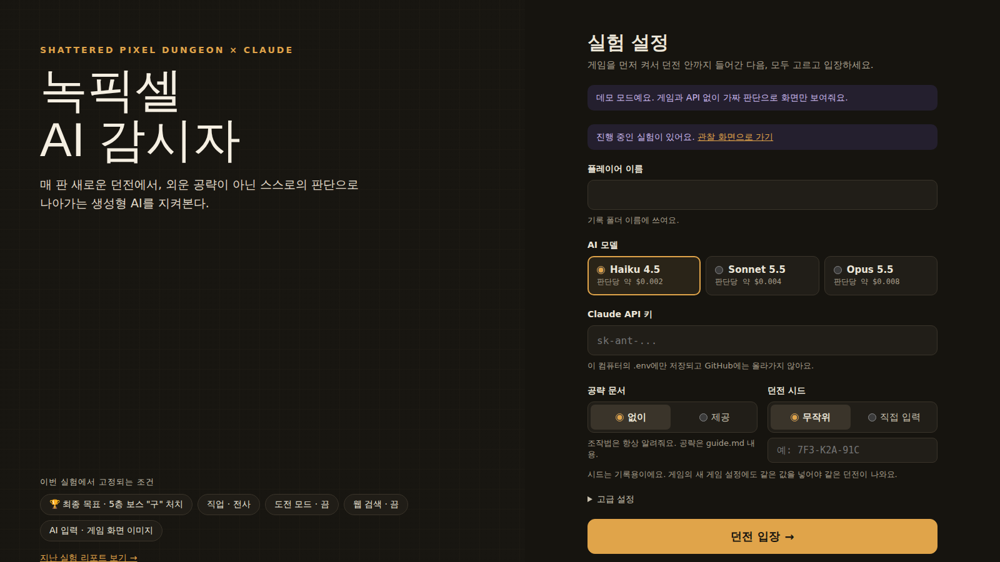
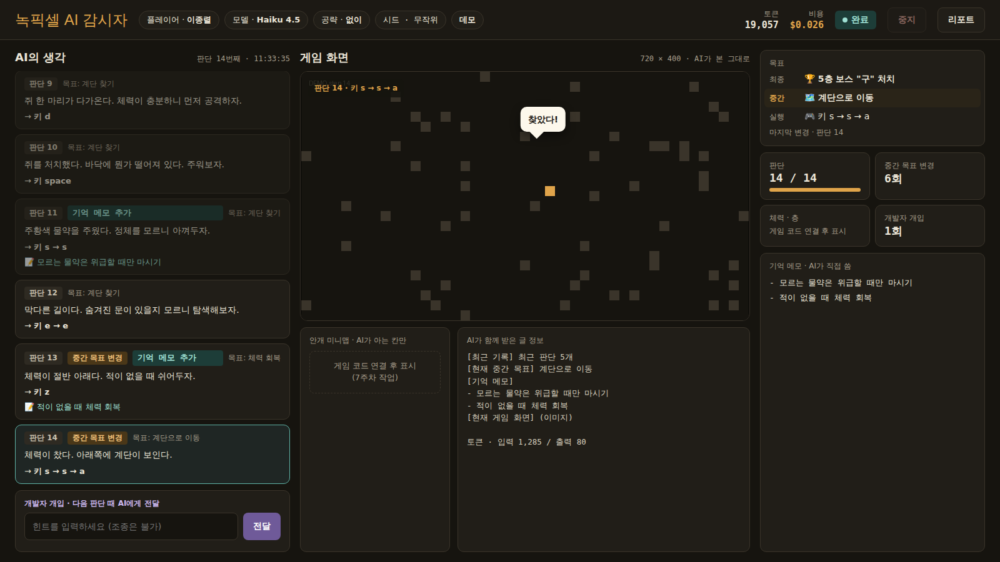
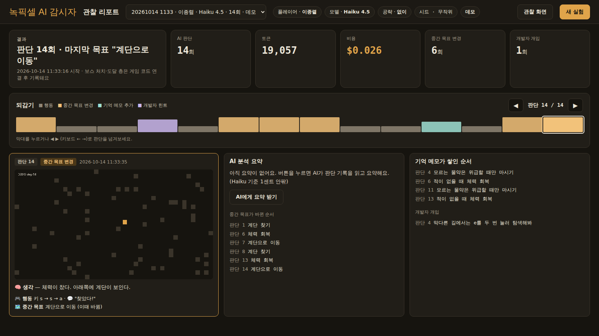

# 녹픽셀 AI 감시자 (nokpixel-ai-watcher)

> 매 판 새로운 던전에서, 외운 공략이 아닌 스스로의 판단으로 나아가는 생성형 AI를 지켜본다.

오픈소스 로그라이크 게임 **Shattered Pixel Dungeon**(녹픽던)을 생성형 AI가 직접 플레이하게 하고, AI가 내리는 판단과 그 이유를 기록·관찰하는 대학 「인공지능 프로젝트」 개별 프로젝트입니다.

| 항목 | 내용 |
|---|---|
| **목적** | AI가 녹픽던을 스스로 클리어하는 과정을 지켜보고, 그 과정에서 AI가 스스로 판단하는지 탐구한다 |
| **방법** | AI가 게임에 쉽게 접근하도록 **게임 화면과 게임 데이터를 실시간으로 함께** 넘겨주고, AI는 **게임 함수 명령**으로 행동한다 |
| **사용자** | 직접 플레이하지 않는 **관찰자**. 지켜보고, 필요하면 힌트를 준다 |
| **최종 목표** | 게임 안 AI 설정에서 단계로 고른다: 0 문 통과(시험용) · 1 5층 보스 구 · 2 10층 · 3 15층 · 4 20층 · 5 25층 보스 · 6 엔딩 (기본 1) |
| **AI 모델** | OpenAI GPT-6 Luna / GPT-6.1 Sol / GPT-6 Astra, Claude Haiku 4.5 / Sonnet 5.5 / Opus 5.5 (실제 판은 모두 GPT-6로 돌렸다) |
| **개발 일지** | [노션 페이지](https://app.notion.com/p/3eb8b0a72c89800f9c25ce49d1a9a8cc) |

## 목차
- [탐구 질문](#탐구-질문)
- [왜 녹픽던인가](#왜-녹픽던인가)
- [시스템 구조](#시스템-구조)
- [AI 활용 방안](#ai-활용-방안)
- [관찰 화면](#관찰-화면)
- [실험 기록과 결과](#실험-기록과-결과)
- [개발 진행](#개발-진행)
- [실행 방법](#실행-방법)
- [저장소 구조](#저장소-구조)
- [참고 사례](#참고-사례)
- [원작과 라이선스](#원작과-라이선스)

## 탐구 질문

> **AI는 스스로 판단하는가, 아니면 아는 것을 꺼내 쓰는 것뿐인가?**

- **불확실한 정보 앞에서**: 감정되지 않은 아이템, 처음 보는 맵에서 AI는 어떻게 판단하는가
- **실패 이후**: 큰 실패를 겪은 뒤 AI의 판단은 어떻게 달라지는가
- **사람과 비교**: 같은 상황에서 사람과 AI의 선택과 이유는 같은가, 다른가

## 왜 녹픽던인가

| 장점 | 설명 |
|---|---|
| 🔁 완전 턴제 | AI가 한 수마다 생각할 시간이 충분하다 |
| 🔓 무료 오픈소스 | 전체 코드가 GPL-3.0으로 공개돼 있어 게임 안에 AI 연결 지점을 만들 수 있다 |
| 💸 적은 비용 | 게임은 무료, AI에게 보내는 사진을 360×640으로 고정해 비용이 낮다 |
| 🎲 매 판 무작위 맵 | 규칙·공략은 알려져 있지만 맵은 매번 새롭다. 외운 공략이 아닌 그 자리의 판단을 볼 수 있다 |
| 🧪 미감정 아이템 | 물약(색)·주문서(룬)·반지(보석)의 정체가 매 판 섞인다. "불확실한 정보"를 다루는 모습을 관찰하기 좋다 |
| 📏 성과가 숫자로 나옴 | 도달 층, 보스 처치, 진행도 이정표 점수로 결과를 비교할 수 있다 |

## 시스템 구조

```
┌───────────────────────────┐  ⑧ 게임 데이터(보이는 것만)   ┌──────────────────────────┐  화면 + [게임 정보]·[지도]  ┌────────────┐
│ 녹픽던 게임 (Java)          │ ───────────────────────────▶ │ AI 관찰기 (Python)         │ ─────────────────────────▶ │ AI 모델     │
│ · 세로 창 (9:16)            │  ① 화면 캡처                  │ web.py · agent.py         │                           │ GPT / Claude│
│ · AI 설정 장면              │ ◀─────────────────────────── │ · 판단 요청·기록           │ ◀───────────────────────── │            │
│ · AIBridge (통로)           │  ⑨ 게임 함수 명령 / 키·클릭   │ · 이정표·숨김 검사          │  생각 + 도구(명령)          └────────────┘
│ · GameState (보이는 것만)    │                              └────────────┬─────────────┘
└───────────────────────────┘                                           │ 기록 (logs/)
                                                                        ▼
                                                     ┌──────────────────────────────────┐
                                                     │ 관찰 패널 · 기록 창 · 리포트          │ ← 관찰자: 지켜보기, 힌트, 일시정지, 중지
                                                     └──────────────────────────────────┘
```

### 판 하나의 흐름
1. 캐릭터 선택 → **AI 설정 장면**(모델, API 키, 공략, 최대 판단, 최종 목표 단계) → [AI로 시작]
2. 던전 1층에 도착하면 AI가 **스스로 시작**한다 (사람은 아무것도 누르지 않는다)
3. 판단마다: 게임이 주인공이 입력을 기다릴 때 **게임 데이터**를 보내고 → 관찰기가 **화면 + 데이터**로 AI에게 묻고 → AI가 **명령**(또는 키·클릭)을 내리면 → 게임이 실행한다
4. 최종 목표 달성, 사망, 타이틀로 나감, 게임 꺼짐, 최대 판단, 중지 중 하나로 **스스로 멈추고**, AI가 다음 판의 자신에게 교훈을 쓴다

### 게임과 관찰기 사이 통로
게임이 묻고 관찰기(`127.0.0.1:8765`)가 답하는 로컬 HTTP입니다. Python이 꺼져 있어도 게임은 멈추지 않고, [AI 없이 시작]은 원작과 같습니다.

| 번호 | 내용 |
|---|---|
| ①~④ | 상태 조회, API 키 보내기, 연결 시험, 판 준비 |
| ⑤⑥⑦ | 던전 도착(AI 시작), 판 끝(AI 멈춤), 살아 있음 신호(끊기면 AI 멈춤) |
| ⑧ | 게임 데이터: 주인공 상태, 가 본 칸 문자 지도, 보이는 적·아이템·계단, 가방, 메시지 |
| ⑨ | 게임 함수 명령: `move_to`, `attack`, `pick_up`, `take_stairs`, `rest`, `search` |

자세한 내용: [시스템 구조](docs/project/architecture.md) · [게임↔Python 연결](docs/project/bridge.md) · [게임 데이터·명령](docs/project/game-state.md)

## AI 활용 방안

[Claude Plays Pokémon](https://github.com/davidhershey/ClaudePlaysPokemonStarter) 방식을 따랐습니다. **짧은 규칙 + 생각은 글로 + 행동은 도구로.**

### 목표의 세 층
```
🏆 최종 목표    단계에서 고름 (기본: 5층 보스 구 처치)   ← 사람이 정해서 준다. 이루면 다음 목표로 잇거나 판을 끝낸다
🗺️ 중간 목표    "계단 찾기", "체력 회복 후 보스 준비"    ← AI가 스스로 세우고 바꾼다
🎮 실행 명령    move_to(20,9), rest(full), 키 d       ← AI가 게임에 내리는 한 번의 지시
```

### AI가 받는 것과 내는 것
| 받는 것 | 내는 것 |
|---|---|
| 게임 화면 이미지 (360×640) | 🧠 **생각** (한국어 2~3문장) |
| **[게임 정보]**: 층·체력·레벨·배고픔·상태이상, 위치와 주변 8칸, 보이는 적, 본 아이템·계단, 가방, 지난 명령 결과, 최근 메시지 | 🛠️ **도구 하나**: 게임 명령 6개, `press_keys`(키 최대 3개), `click`(화면 좌표) |
| **[지도]**: 가 본 칸만 담은 문자 지도 (좌표 눈금) | 도구 안에: 💬 말풍선, 🗺️ 중간 목표, 🎯👀 되새김, 📝 기억 메모 추가·지우기 |
| 최근 판단, 중간 목표, 기억 메모, (있으면) 힌트·큰 점검 요청 | |
| (조건에 따라) 공략 문서, 지난 판의 교훈 | |

### 보이는 것만 준다
AI에게는 **플레이어 화면에 보이는 것만** 줍니다. 걸러 내기는 게임 안(`GameState.java`) 한 곳에서 하고, 숨길 값은 게임 밖으로 내보내지 않습니다.
- 안 가 본 칸은 빈칸, 숨겨진 문은 벽, 숨겨진 함정은 바닥, 정체를 드러내기 전 미믹은 "상자"
- 아이템은 화면 이름만 (미감정 물약은 색 이름), 시야 밖 적·배고픔 숫자·적 체력 숫자·시드는 넣지 않음
- 모르는 칸으로 가는 명령은 실행하지 않음 (성공·실패만으로 안 본 지형을 알 수 있어서)
- 판이 끝나면 데이터에 시드·게임 내부 이름이 새지 않았는지 **자동 검사** (`check_hidden.py`)

### 생각이 딴 길로 빠지지 않게: 되새김
AI가 쓴 생각·메모는 다음 판단의 입력으로 다시 들어갑니다. 한 번 지어낸 정보가 메모로 굳지 않게, 매 행동마다 두 가지를 함께 적게 합니다.

| 되새김 | 거르는 것 |
|---|---|
| 🎯 `check_goal`: 이 행동 → 중간 목표 → 최종 목표가 어떻게 이어지나 (한 줄) | 목표에서 새는 행동 |
| 👀 `basis`: 근거가 **화면** / **기록** / **추측** 중 무엇인가 | 없는 정보 끌어오기 |

- 기억 메모에는 번호가 붙고, 틀린 메모는 AI가 스스로 지웁니다.
- **큰 점검**: 10번째 판단마다, 중간 목표를 바꾼 다음 판단에 지금까지를 돌아보게 합니다.

### 판을 넘어가는 교훈
판이 끝나면 AI가 **다음 판의 자신에게 남기는 교훈**을 직접 씁니다. 다음 판에서 그 교훈을 이어받을 수 있습니다. 원래 알던 지식이 아니라 **스스로 겪어서 만든 지식**으로 판단이 바뀌는지를 봅니다.

### 결과를 세밀하게: 진행도 이정표
"보스 처치 O/X + 도달 층"만으로는 판끼리 차이가 거칠어서, 1~5층 이정표 12개(첫 적 처치 → 층 도착 → 장비 강화 → 보스전 → 구 처치, 51점 만점)를 **게임 데이터로 자동 기록**합니다. OpenAI VPT 논문의 단계별 보상표를 **학습이 아니라 평가용**으로 빌려 왔고, AI에게는 알려주지 않습니다. [기준](docs/project/progress-milestones.md)

### 실험 조건 (판마다 `config.json`에 기록)
| 조건 | 값 |
|---|---|
| AI 모델 | 위 6종 |
| AI가 받는 정보 | 게임에서 시작한 판: 화면 + 게임 데이터 (11/14부터) · 명령줄 판: 화면만 |
| 도구 | 게임에서 시작한 판: 명령 + 키·클릭 (11/15부터) |
| 공략 문서 | 없이 / 제공 (`guide.md` v2: 1~5층 적·보스 구·상태이상·아이템, 게임 설명문 요약) |
| 지난 판의 교훈 | 이어받지 않음 / 이어받음 |
| 최종 목표 | 단계 0~6, 달성하면 다음 목표로 / 끝내기 |
| 개입 | 힌트·일시정지·F12 해제 횟수. 하나라도 있으면 리포트에 "⭐ 개입 있는 판" |

## 관찰 화면

화면 두 개를 나란히 둡니다: **게임(왼쪽, 세로)** + **관찰 패널(오른쪽)**. 판단별 상세는 버튼으로 여는 **기록 창**에서 봅니다.

| 화면 | 내용 |
|---|---|
| 게임 안 **AI 설정** | 캐릭터 선택 뒤. AI 관찰기 켜기, 모델, API 키(가려서 입력, 게임에는 저장 안 함), 연결 시험, 공략, 최대 판단, 교훈, 최종 목표 단계, 달성하면 |
| **관찰 패널** (`/panel`) | 상태, 판단 n/최대, 비용, 게임 창 신호등, **체력·층·배고픔·진행도**(실시간), 최종·중간 목표, 지금 생각(크게)·행동, 힌트, ⏸ 일시정지/▶ 재개, 한도 도달 시 [+10]/[+30]/[여기서 끝내기], 중지 |
| **기록 창** (`/log`) | 판단 목록, 고른 판단의 목표·생각·행동·명령 결과·그때 AI가 본 화면·그때 게임 데이터(문자 지도 등) |
| **관찰 리포트** (`/report`) | 되감기, 통계, 끝난 이유·층, 이정표 점수, 개입 횟수, 중간 목표 변화, 기억 메모 순서, 교훈, AI 분석 요약 |

실행 중에는 게임 창에 **사람 입력 잠금**이 걸려(AI 입력은 통과) 실수로 조작이 섞이지 않습니다. 일시정지하면 풀리고, F12로 언제든 비상 해제할 수 있습니다.

아래는 10/14에 데모 모드로 띄운 **초기 화면**입니다. 지금 화면은 [노션 개발 일지](https://app.notion.com/p/3eb8b0a72c89800f9c25ce49d1a9a8cc)의 10/31·11/02 기록에 있습니다.

| 실험 설정 (초기) | 관찰 화면 (초기) | 관찰 리포트 |
|---|---|---|
|  |  |  |

## 실험 기록과 결과

> 아래는 실제로 돌린 판의 기록만 정리한 것입니다. 판마다 조건이 다르고 판 수가 적어서, **비교 실험이 아니라 관찰 기록**입니다.

### 실제 판 (게임에서 AI가 직접 조작한 판)
| 날짜 | 판 | 모델 | 판단 | 끝 | AI가 받은 것 |
|---|---|---|---|---|---|
| 10/25 | 첫 실제 조작 | Luna | 10 | 1층 | 화면 (가로 720×400) |
| 11/02 | 182004 | Luna | 34 | 중지 · 1층 | 화면 |
| 11/02 | 192529 | Luna | 30 | 최대 판단 · 1층 | 화면 + 공략 v1 |
| 11/04 | 103820 | Luna | 40 | 타이틀로 나감 · 1층 | 화면 |
| 11/04 | 104925 | Astra | 30 | 사망 · 1층 | 화면 |
| 11/04 | 111303 | Astra | 63 | 사망 · 1층 | 화면 + 공략 v1 + 교훈 |
| 11/14 | 5판 | Luna 4 · Astra 1 | 4~15 | 1층 | 화면 + 게임 데이터 + 공략 v2 |
| 11/15 | 000352 | Luna | 68 | 사망 · 1층 | 화면 + 게임 데이터 + 명령 + 공략 v2 |

- **2층에 도착한 판은 없습니다.** 가장 많이 간 판의 이정표는 첫 적 처치 + 첫 아이템 줍기(51점 중 2점, 11/15)
- 실제 판 비용 합계는 약 \$3.5이고, 그중 약 \$3.3이 Astra 판입니다 (판단 1번에 Luna 약 \$0.0005~0.0008, Astra 약 \$0.03)
- 대부분의 판에 힌트·일시정지(개입)가 섞여 있습니다. 판별 개입 횟수는 리포트와 시험 기록에 있습니다

### 관찰한 것
| 장면 | 판 |
|---|---|
| 1층 **올라가는 계단(입구)을 출구로 알고 거듭 밟음**. "아직 떠날 수 없습니다" 안내를 여러 번 띄움 | 10/25, 11/02, 11/04 |
| 층이 바뀌지 않았는데 **"계단에 도달했다"고 단정**하고 같은 방향 반복 | 11/02 192529 |
| "올라가는 계단"이라는 **힌트를 받고도** "내려가는 계단"으로 보고 다시 감 | 11/04 103820 |
| 이전 판 교훈("낭떠러지는 크게 다침")을 근거로 **개발자 힌트를 거절** | 11/04 111303 |
| 게임 데이터는 맞았지만 **문자 지도의 열을 한 칸씩 잘못 세어** 벽에 부딪힘 → "주변 8칸" 줄을 더함 | 11/14 |
| 게임 명령을 주자 목표 0(문 통과)을 **판단 4번에 힌트 없이** 달성 (키만 쓴 판: 판단 13번, 힌트 2번) | 11/14 → 11/15 |
| "적이 보이면 계단을 탈 수 없다"는 규칙을 알아내지 못하고 계단 앞에서 싸우다 사망 | 11/15 |
| 판 안에서는 같은 실수를 되풀이하고, **판이 끝난 뒤에야** 교훈을 정확히 씀 | 대부분의 판 |

### 지금까지의 해석 (추측)
- AI는 **판단 자체**보다 판단을 **행동으로 옮기는 단계**(방향 키로 바꾸기, 지도 글자 세기)에서 많이 막혔다. 게임 함수 명령을 주자 진행이 빨라졌다. 다만 같은 판에 주변 8칸 줄도 함께 들어가 있어서, 무엇이 효과를 냈는지는 나눌 수 없다
- 정보를 줘도 "계단이 있을 것"이라는 **아는 것을 앞세우는** 장면이 반복됐다
- 판 수가 적고 조건이 판마다 달라서, 탐구 질문에 대한 답으로 확정할 수는 없다

날짜별 시험 결과: [docs/test-results/](docs/test-results/)

## 개발 진행

| 날짜 | 한 일 |
|---|---|
| 9/30 | 기획: 주제, 탐구 질문, 핵심 기능, 일정 |
| 10/13 | 저장소 생성, 녹픽던 빌드 |
| 10/14 | 시스템·AI 활용·UI 설계, MVP(화면 보고 키로 플레이) + 관찰 웹 화면(데모), 되새김·기억 메모·큰 점검·교훈 |
| 10/25 | OpenAI 연결, 화면 캡처·입력 안전장치, **AI 첫 실제 조작** |
| 10/26 | 관찰 화면 여러 창, 실행 중 입력 잠금 |
| 10/31 | 두 창 관찰 화면, 세로 게임 창(모니터 3종), **게임 안 AI 설정 장면** |
| 11/02 | 게임 ↔ 관찰기 연결, **던전 도착하면 AI 자동 시작·판 끝나면 자동 멈춤**, 일시정지·한도 도달·개입 기록 |
| 11/04 | **게임 데이터 만들기(보이는 것만)**, 진행도 이정표 자동 기록, 숨김 검사, 공략 v2 |
| 11/14 | **게임 데이터를 AI 입력으로**, 관찰 패널 실시간 체력·층·배고픔·진행도, **최종 목표 단계** |
| 11/15 | **게임 함수 명령 6개** |

### 아직 안 된 것
- ⬜ 같은 조건으로 여러 판을 돌린 비교 실험
- ⬜ 보스 처치 판정을 실제 판에서 확인 (데모로만 확인)
- ⬜ 사망 원인 기록
- ⬜ 게임이 판단을 요청할 때만 AI 부르기 (`Hero.ready()` 기준, [설계](docs/project/decision-points.md)). 지금은 주인공이 입력을 기다릴 때마다 묻는다
- ⬜ 아이템 사용 명령 (지금은 키·클릭으로)
- ⚠️ 주인공 정보 창이 열리면 화면 사진에 시드가 보인다 (게임 데이터에는 없음)

## 실행 방법

Windows 기준입니다. 화면 캡처·입력 잠금·키 입력이 Windows 전용입니다.

### 1. 준비
1. [JDK 21](https://adoptium.net/) 설치, Python 3 설치
2. AI 관찰기 패키지 설치 (처음 한 번)
   ```bash
   cd ai-bridge
   pip install -r requirements.txt
   ```
3. OpenAI 또는 Anthropic API 키 (게임 안에서 넣는다)

### 2. 게임 실행
```bash
gradlew.bat desktop:debug
```
- 처음 실행은 필요한 파일을 내려받느라 몇 분 걸려요.
- 게임 창은 **세로(9:16)** 이고 모니터에 맞춰 크기를 골라요 (2560×1440 → 720×1280, **1920×1080 → 540×960**, 1366×768 → 360×640). 직접 고르기: `--args="--display=768"`

### 3. AI로 한 판
1. 캐릭터 선택 → [시작] → **AI 설정**
2. [AI 관찰기 켜기] → [키 입력] → [연결 시험]
3. 모델·공략·최대 판단·최종 목표를 고르고 [AI로 시작]
4. 던전 1층에 도착하면 AI가 스스로 시작합니다. 관찰 패널에서 지켜봅니다

- 사람이 직접 하려면 [AI 없이 시작] (원작과 같음)
- 게임·API 없이 화면만 둘러보기: `cd ai-bridge` → `python web.py --demo`
- 명령줄로 바로 돌리기: `python mvp.py` (자세한 옵션: [ai-bridge/README.md](ai-bridge/README.md))

> ⚠️ **API 키는 절대 GitHub에 올리지 마세요.** 키는 `ai-bridge/.env`에만 저장되고, 이 파일은 `.gitignore`로 제외돼 있어요. 실제 판은 API 비용이 듭니다.

## 저장소 구조

| 경로 | 내용 |
|---|---|
| `core/`, `desktop/`, `SPD-classes/` … | 녹픽던 원본 게임 코드 (Java, v4.0.2 기준) |
| `core/.../AIBridge.java` | **추가**: 게임 ↔ AI 관찰기 통로 (①~⑨), 명령 실행, 목표 판정 |
| `core/.../GameState.java` | **추가**: 게임 데이터 만들기와 숨기기 (보이는 것만) |
| `core/.../scenes/AISetupScene.java` | **추가**: 캐릭터 선택 뒤 AI 설정 장면 |
| `desktop/.../DesktopLauncher.java` | **수정**: 세로 창 3단계 크기, 모바일 화면·배율 고정 |
| `core/.../scenes/HeroSelectScene.java`, `GameScene.java`, `windows/WndGame.java`, `SPDSettings.java`, `messages/scenes/scenes*.properties`, `SPD-classes/.../TextInput.java` | **수정** (연결 지점만): [시작] → AI 설정, 통로 호출 몇 줄, 게임 메뉴의 관찰기 켜기, AI 설정 값 기억, 문구, 키 입력 가리기. 게임 규칙은 그대로 |
| `ai-bridge/` | **추가**: AI 플레이어(`agent.py`), 관찰 웹 화면(`web.py`, `web/`), 입력 잠금(`input_lock.py`), 창 배치(`window_layout.py`), 숨김 검사(`check_hidden.py`), 명령줄 실행(`mvp.py`), 공략(`guide.md`) |
| `docs/project/` | **추가**: 시스템 구조, 게임↔Python 연결, 게임 데이터·명령, 판단 요청과 숨길 정보, 진행도 이정표 |
| `docs/test-results/` | **추가**: 날짜별 시험 결과 (실제로 돌린 것만) |
| `CLAUDE.md`, `.claude/settings.json` | **추가**: Claude Code가 이 저장소에서 따르는 규칙, `.env` 읽기 금지 설정 |
| `docs/images/` | **추가**: UI 화면 캡처 (초기) |
| `docs/getting-started-*.md` | 원본 게임 빌드 안내 (원작자 작성) |

## 참고 사례

| 사례 | 참고한 점 |
|---|---|
| [Claude Plays Pokémon](https://github.com/davidhershey/ClaudePlaysPokemonStarter) | 짧은 규칙, 생각은 글로·행동은 도구로, 기록 요약 |
| [Gemini Plays Pokémon](https://blog.jcz.dev/the-making-of-gemini-plays-pokemon) | 관찰 화면 설계, 개발자 개입, 단순하게 시작해 기능 추가 |
| [VPT (OpenAI, 2022)](https://arxiv.org/abs/2206.11795) | 단계별 보상표 → 진행도 이정표(평가용), "지시보다 학습된 습관을 따른다"는 선행 결과 |
| [Voyager](https://voyager.minedojo.org/) | AI가 스스로 목표를 세우고 쪼개는 방식, 상태를 글로 전달 |
| [Ghost in the Minecraft](https://arxiv.org/abs/2305.17144) | 공략(위키) 텍스트를 AI에 제공하는 실험 |
| [BALROG](https://arxiv.org/abs/2411.13543) | 게임을 텍스트로 바꿔 AI 평가, "아는 것과 하는 것의 차이" |

## 원작과 라이선스

이 프로젝트는 [00-Evan/shattered-pixel-dungeon](https://github.com/00-Evan/shattered-pixel-dungeon)을 포크해 만들었습니다.
Shattered Pixel Dungeon은 Evan Debenham이 [Watabou의 Pixel Dungeon](https://github.com/00-Evan/pixel-dungeon-gradle)을 바탕으로 만든 게임이며, 원본 README는 [`docs/ORIGINAL_README.md`](docs/ORIGINAL_README.md)에 보존돼 있습니다.

원작과 마찬가지로 이 저장소의 코드는 **GNU GPL v3.0** 라이선스를 따릅니다. 자세한 내용은 [`LICENSE.txt`](LICENSE.txt)를 보세요.
