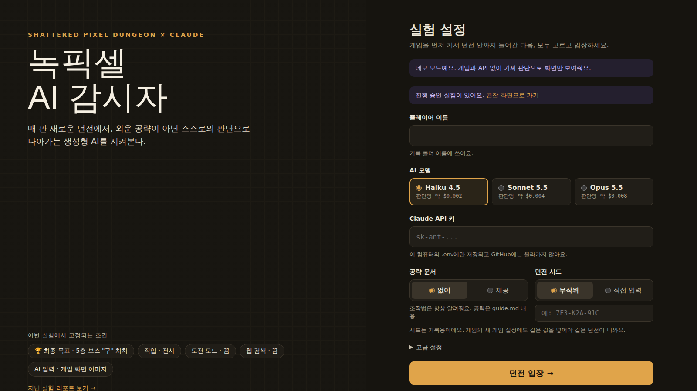
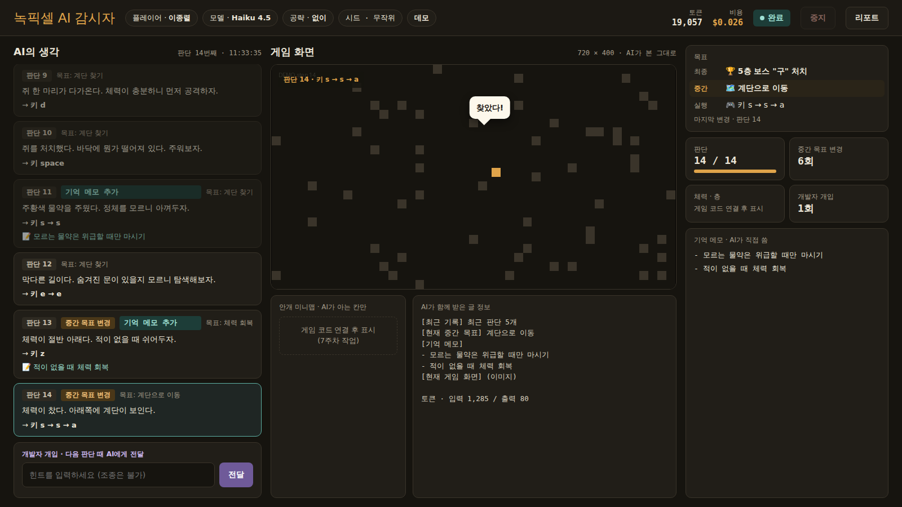
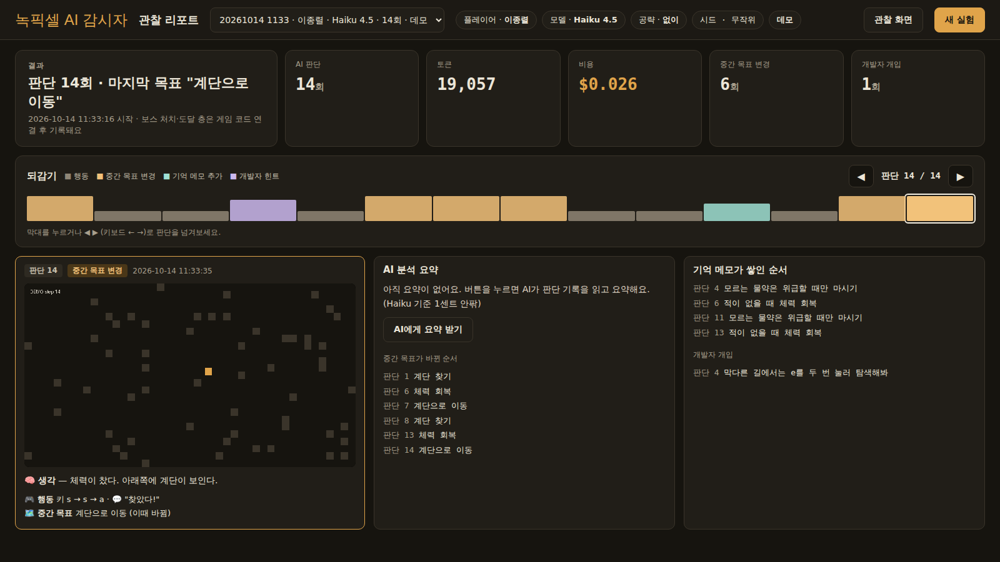

# 녹픽셀 AI 감시자 (nokpixel-ai-watcher)

> 매 판 새로운 던전에서, 외운 공략이 아닌 스스로의 판단으로 나아가는 생성형 AI를 지켜본다.

오픈소스 로그라이크 게임 **Shattered Pixel Dungeon**(녹픽던)을 생성형 AI(Claude)가 직접 플레이하게 하고, AI가 내리는 판단과 그 이유를 기록·관찰하는 대학 「인공지능 프로젝트」 개별 프로젝트입니다.

| 항목 | 내용 |
|---|---|
| **개발 목적** | 생성형 AI가 녹픽던을 어떻게 클리어하는지, 그 과정에서 AI가 스스로 선택하는지를 탐구한다 |
| **예상 사용자** | AI가 스스로 게임을 클리어할 수 있는지 궁금한 사람들 (사용자는 직접 플레이하지 않는 **관찰자**) |
| **활용 상황** | 불확실한 정보 속에서 AI가 내린 판단을 기록·분석하여 사람의 생각 방식과 비교한다 |
| **최종 목표** | AI가 5층 보스 "구(Goo)"를 처치하기까지의 판단을 관찰 (보스 처치 여부와 도달 층을 함께 기록) |
| **기획서** | [노션 페이지](https://app.notion.com/p/3eb8b0a72c89800f9c25ce49d1a9a8cc) |

## 목차
- [탐구 질문](#탐구-질문)
- [왜 녹픽던인가](#왜-녹픽던인가)
- [시스템 구조](#시스템-구조)
- [AI 활용 방안](#ai-활용-방안)
- [UI / UX](#ui--ux)
- [개발 일정과 진행 상황](#개발-일정과-진행-상황)
- [실행 방법](#실행-방법)
- [저장소 구조](#저장소-구조)
- [참고 사례](#참고-사례)
- [원작과 라이선스](#원작과-라이선스)

## 탐구 질문

> **AI는 스스로 판단하는가, 아니면 아는 것을 꺼내 쓰는 것뿐인가?**

- **불확실한 정보 앞에서**: 감정되지 않은 아이템, 처음 보는 맵에서 AI는 어떻게 판단하는가
- **실패 이후**: 큰 실패를 겪은 뒤 AI의 판단은 어떻게 달라지는가
- **사람과 비교**: 같은 상황에서 사람과 AI의 선택과 이유는 같은가, 다른가

## 왜 녹픽던인가

| 장점 | 설명 |
|---|---|
| 🔁 완전 턴제 | AI가 한 수마다 생각할 시간이 충분하다 |
| 🔓 무료 오픈소스 | 전체 코드가 GPL-3.0으로 공개돼 있어 AI와 연결할 수 있다 |
| 💸 적은 비용 | 게임은 무료, 창을 720×400으로 고정해 스크린샷 비용도 낮다 |
| 🎲 매 판 무작위 맵 | 규칙·공략은 알려져 있지만 맵은 매번 새롭다. 외운 공략이 아닌 그 자리의 판단을 볼 수 있다 |
| 🧪 미감정 아이템 | 물약(색)·주문서(룬)·반지(보석)의 정체가 매 판 섞인다. "불확실한 정보"를 다루는 모습을 관찰하기 좋다 |
| 📏 성과가 숫자로 나옴 | 도달 층, 보스 처치 여부로 결과를 객관적으로 비교할 수 있다 |
| 📚 풍부한 공략 정보 | "공략을 읽은 AI vs 안 읽은 AI" 비교 실험이 가능하다 |

## 시스템 구조

### 현재 (MVP)
AI가 사람처럼 **게임 화면을 보고 키보드·마우스로 조작**합니다. 게임 코드는 창 크기 고정 외에 건드리지 않았습니다.

```
┌──────────────────────┐   ① 스크린샷    ┌──────────────────────────┐   ② 이미지 + 글   ┌──────────────┐
│  녹픽던 게임 (Java)    │ ─────────────▶ │  ai-bridge (Python)       │ ───────────────▶ │  Claude API   │
│  창 720×400 고정       │                │  · 화면 캡처 · 기록 저장     │                  │              │
│                      │ ◀───────────── │  · 도구 → 실제 입력 변환     │ ◀─────────────── │  생각 + 도구   │
└──────────────────────┘   ④ 키·클릭     └────────────┬─────────────┘   ③ 생각 + 행동   └──────────────┘
                                                     │ ⑤ 기록
                                                     ▼
                                        ┌──────────────────────────┐
                                        │  관찰 웹 화면               │ ← 관찰자: 지켜보기, 힌트, 중지
                                        │  설정 → 관찰 → 리포트        │
                                        └──────────────────────────┘
```

### 입력 → 처리 → 출력

| 📥 입력 | ⚙️ 처리 | 📤 출력 |
|---|---|---|
| 실험 설정 (모델, 공략 유무, 시드) | ① 게임 화면 캡처 | 게임 속 캐릭터의 행동 (키·클릭) |
| 게임 화면 (720×400 이미지) | ② 최근 판단·중간 목표·기억 메모·힌트와 함께 Claude에 전달 | 관찰 화면: AI의 생각, 말풍선, 목표, 기억 메모 |
| 개발자 개입 힌트 | ③ Claude가 생각을 쓰고 도구로 행동 결정 → ④ 실제 입력으로 실행·기록 | 관찰 리포트: 되감기, 통계, AI 분석 요약 |

출력된 행동이 게임 상황을 바꾸고, 바뀐 화면이 다시 입력이 되는 **고리 구조**입니다.

### 다음 단계 (예정)
게임 코드에 연결 지점을 추가해 **판단 요청 시점**(`Hero.ready()`)과 **게임 속 글 정보**(체력, 층, 주변 적, 가방)를 직접 받아올 예정입니다.

자세한 내용: [docs/project/architecture.md](docs/project/architecture.md)

## AI 활용 방안

[Claude Plays Pokémon](https://github.com/davidhershey/ClaudePlaysPokemonStarter) 방식을 따랐습니다. **짧은 규칙 + 생각은 글로 + 행동은 도구로.**

### 목표의 세 층
```
🏆 최종 목표    5층 보스 "구" 처치                 ← 우리가 정해서 준다
🗺️ 중간 목표    "계단 찾기", "체력 회복 후 보스 준비"  ← AI가 스스로 세우고 바꾼다
🎮 실행 명령    "키 d", "클릭 (360, 180)"            ← AI가 게임에 내리는 한 번의 지시
```

### AI가 받는 것과 내는 것
| 받는 것 | 내는 것 |
|---|---|
| 게임 화면 이미지 (720×400) | 🧠 **생각** (한국어 2~3문장) |
| 최근 판단 5개 (큰 점검 때는 10개) | 🛠️ **도구 하나**: `press_keys`(키 최대 3개) 또는 `click`(화면 좌표) |
| 현재 중간 목표, 번호 붙은 기억 메모 | 도구 안에: 💬 말풍선, 🗺️ 중간 목표, 🎯👀 되새김, 📝 기억 메모 추가·지우기 |
| (있으면) 개발자 힌트, 큰 점검 요청 | |
| (조건에 따라) 공략 문서, 지난 판의 교훈 | |

### 생각이 딴 길로 빠지지 않게: 되새김
AI가 쓴 생각·메모는 다음 판단의 입력으로 다시 들어갑니다. 한 번 지어낸 정보(화면에 없는 문, 확인 안 된 물약의 정체)가 메모로 굳으면 그 방향으로 계속 갈 수 있어서, 매 행동마다 두 가지를 함께 적게 합니다.

| 되새김 | 거르는 것 |
|---|---|
| 🎯 `check_goal`: 이 행동 → 중간 목표 → 5층 보스 처치가 어떻게 이어지나 (한 줄) | 목표에서 새는 행동 |
| 👀 `basis`: 근거가 **화면** / **기록** / **추측** 중 무엇인가 | 없는 정보 끌어오기 |

- **기억 메모**에는 번호(M1, M2…)와 적은 시점이 붙고, 틀린 메모는 AI가 `memo_remove`로 스스로 지웁니다.
- **큰 점검**: 10번째 판단마다, 중간 목표를 바꾼 다음 판단에 "최종 목표에 가까워졌나, 중간 목표가 맞나, 틀린 메모는 없나"를 생각에 쓰게 합니다.
- 근거가 추측인 판단과 메모를 지운 순간은 리포트에 따로 표시합니다. 막는 것만이 아니라 **관찰 데이터**이기 때문입니다.

### 결과를 세밀하게: 진행도 이정표 (예정)
"보스 처치 O/X + 도달 층"만으로는 판끼리 차이가 거칠어서, 1~5층 이정표(첫 처치 → 층 도착 → 장비 강화 → 보스전 → 구 처치)에 단계별 점수를 매깁니다. OpenAI VPT 논문의 단계별 보상표를 **학습이 아니라 평가용**으로 빌려 왔습니다. AI에게는 알려주지 않습니다.
자세한 내용: [docs/project/progress-milestones.md](docs/project/progress-milestones.md)

### 판을 넘어가는 교훈: 꺼내 쓰기를 넘어서
판이 끝나면 AI가 **다음 판의 자신에게 남기는 교훈**을 직접 씁니다 (`lessons.md`, 각 줄에 근거 판단 번호). 다음 판 설정에서 그 교훈을 이어받을 수 있습니다. 원래 알던 지식이 아니라 **스스로 겪어서 만든 지식**으로 판단이 바뀌는지를 봅니다.

### 실험 조건
| 조건 | 설명 |
|---|---|
| AI 모델 | Claude: Haiku 4.5 / Sonnet 5.5 / Opus 5.5 · OpenAI: GPT-6 Luna / GPT-6.1 Sol / GPT-6 Astra |
| 공략 문서 | 없이 / 제공 (조작법은 항상 제공, AI가 원래 아는 기본 지식은 유지) |
| 지난 판의 교훈 | 이어받지 않음 / 이어받음 (AI가 지난 판이 끝나고 직접 쓴 교훈) |
| 웹 검색 | 항상 끔 |
| 고정 | 직업 전사, 도전 모드 끔 |

### 판단 요청 (예정)
게임 코드 연결 후에는 매 행동이 아니라 **판단이 필요할 때만** AI를 부릅니다.

```
[AI 판단 요청]
 ├─ 기본 ─── Hero.ready() ─── ① 명령 완료   ② 층 이동
 ├─ A그룹 ── Hero.ready() ─── ③ 돌발 상황 32가지 (새 적, 큰 피해, 함정 등)
 └─ B그룹 ── 별도 감지 ────── ④ 선택 창 13가지  ⑤ 추가 경고 4가지
```
AI에게 숨길 정보(C그룹: 안 가본 맵, 미감정 아이템의 정체 등)도 정리했습니다.
자세한 내용: [docs/project/decision-points.md](docs/project/decision-points.md)

## UI / UX

관찰자는 직접 플레이하지 않고 **설정 → 관찰 → 리포트** 순서로 AI를 지켜봅니다. 아래는 데모 모드로 실제 띄운 화면입니다.

### ① 실험 설정
로그인하듯 한 화면에서 플레이어 이름, AI 모델, API 키, 공략 유무, 시드를 고르고 **던전 입장**.



### ② 관찰 화면
왼쪽 **AI의 생각**, 가운데 **AI가 본 게임 화면 + 말풍선**, 오른쪽 **목표·기억 메모**. 개발자 힌트 입력과 중지 버튼이 있습니다.



### ③ 관찰 리포트 · 되감기
판단을 하나씩 거슬러 올라가며 당시 화면·생각·행동을 확인하고, AI 분석 요약을 받습니다.



> 체력·층, 미니맵, 보스 처치 여부 칸은 게임 코드 연결 후 채워질 예정입니다.

## 개발 일정과 진행 상황

| 주차 | 기간 | 목표 | 상태 |
|---|---|---|---|
| 6주차 | 9/30 ~ 10/13 | 기획 확정, 개발 환경 준비 | ✅ 기획 확정 · 저장소 생성 · 게임 빌드 성공 |
| 7주차 | 10/14 ~ 10/20 | 시스템·UI 설계, 게임 상태 읽기 | 🔄 진행 중 |
| 8주차 | 10/21 ~ 10/27 | (중간고사) AI 연결 최소 버전 | ⬜ 예정 |
| 9주차 | 10/28 ~ 11/3 | 💬 면담 1 · 기본 관찰 화면 | ⬜ 예정 |
| 10주차 | 11/4 ~ 11/10 | 💬 면담 2 · 부가 기능, 기능 완성 | ⬜ 예정 |
| 11주차 | 11/11 ~ 11/17 | 💬 면담 3 · 실험, 결과물 완성(11/14), 발표 준비 | ⬜ 예정 |
| 12주차 | 11/18 | 🎤 최종 발표 | ⬜ 예정 |

**7주차 (10/14) 진행 내용**
- ✅ 게임 창 720×400 고정
- ✅ 시스템 구조, AI 활용 방안, 판단 요청 설계 문서
- ✅ UI/UX 시안 (설정 · 관찰 · 리포트)
- ✅ MVP: AI가 화면을 보고 키보드·마우스로 플레이 + 관찰 웹 화면 (데모 모드 확인)
- ✅ 되새김(목표 연결·근거), 기억 메모 번호·지우기, 큰 점검, 판을 넘어가는 교훈 (데모 모드 확인)
- ⬜ API 키 발급 후 실제 게임에서 MVP 실행
- ⬜ 게임 상태를 글로 추출 (게임 코드 연결)

## 실행 방법

### 1. 게임 실행 (Java)
1. [JDK 21](https://adoptium.net/) 설치
2. 저장소를 내려받은 폴더에서 실행
   ```bash
   gradlew.bat desktop:debug      # Windows
   ./gradlew desktop:debug        # macOS / Linux
   ```
   처음 실행은 필요한 파일을 내려받느라 몇 분 걸려요. 창은 720×400으로 고정돼요.

### 2. AI 관찰 화면 실행 (Python)
```bash
cd ai-bridge
pip install -r requirements.txt
python web.py --demo     # 게임·API 없이 화면만 둘러보기
python web.py            # 실제 실행 (Windows, Claude API 키 필요)
python web.py --panels   # 세 창 관찰 화면: 게임(입력 잠금) + 지금 AI는 + 판단 기록·개입
```
자세한 내용: [ai-bridge/README.md](ai-bridge/README.md)

> ⚠️ **API 키는 절대 GitHub에 올리지 마세요.** `ai-bridge/.env`에만 저장되고, 이 파일은 `.gitignore`로 제외돼 있어요.

## 저장소 구조

| 경로 | 내용 |
|---|---|
| `core/`, `desktop/`, `SPD-classes/` … | 녹픽던 원본 게임 코드 (Java, v4.0.2 기준) |
| `desktop/.../DesktopLauncher.java` | **수정**: 게임 창 720×400 고정 |
| `ai-bridge/` | **추가**: AI 플레이어(`agent.py`), 관찰 웹 화면(`web.py`, `web/`), 세 창 화면의 입력 잠금(`input_lock.py`)·창 배치(`window_layout.py`), 명령줄 실행(`mvp.py`), 공략 문서(`guide.md`) |
| `docs/project/` | **추가**: 시스템 구조, 판단 요청과 숨길 정보, 진행도 이정표 |
| `CLAUDE.md`, `.claude/settings.json` | **추가**: Claude Code(IntelliJ·VS Code)가 이 저장소에서 따르는 규칙, `.env` 읽기 금지 설정 |
| `docs/images/` | **추가**: UI 화면 캡처 |
| `docs/test-results/` | **추가**: 날짜별 테스트 결과 기록 (`test-results-YYYY-MM-DD.txt`) |
| `docs/getting-started-*.md` | 원본 게임 빌드 안내 (원작자 작성) |

## 참고 사례

| 사례 | 참고한 점 |
|---|---|
| [Claude Plays Pokémon](https://github.com/davidhershey/ClaudePlaysPokemonStarter) | 짧은 규칙, 생각은 글로·행동은 도구로, 기록 요약 |
| [Gemini Plays Pokémon](https://blog.jcz.dev/the-making-of-gemini-plays-pokemon) | 관찰 화면 설계, 개발자 개입, 단순하게 시작해 기능 추가 |
| [VPT (OpenAI, 2022)](https://arxiv.org/abs/2206.11795) | 단계별 보상표 → 진행도 이정표(평가용), "지시보다 학습된 습관을 따른다"는 선행 결과 |
| [Voyager](https://voyager.minedojo.org/) | AI가 스스로 목표를 세우고 쪼개는 방식 |
| [Ghost in the Minecraft](https://arxiv.org/abs/2305.17144) | 공략(위키) 텍스트를 AI에 제공하는 실험 |
| [BALROG](https://arxiv.org/abs/2411.13543) | 게임을 텍스트로 바꿔 AI 평가, "아는 것과 하는 것의 차이" |

## 원작과 라이선스

이 프로젝트는 [00-Evan/shattered-pixel-dungeon](https://github.com/00-Evan/shattered-pixel-dungeon)을 포크해 만들었습니다.
Shattered Pixel Dungeon은 Evan Debenham이 [Watabou의 Pixel Dungeon](https://github.com/00-Evan/pixel-dungeon-gradle)을 바탕으로 만든 게임이며, 원본 README는 [`docs/ORIGINAL_README.md`](docs/ORIGINAL_README.md)에 보존돼 있습니다.

원작과 마찬가지로 이 저장소의 코드는 **GNU GPL v3.0** 라이선스를 따릅니다. 자세한 내용은 [`LICENSE.txt`](LICENSE.txt)를 보세요.
