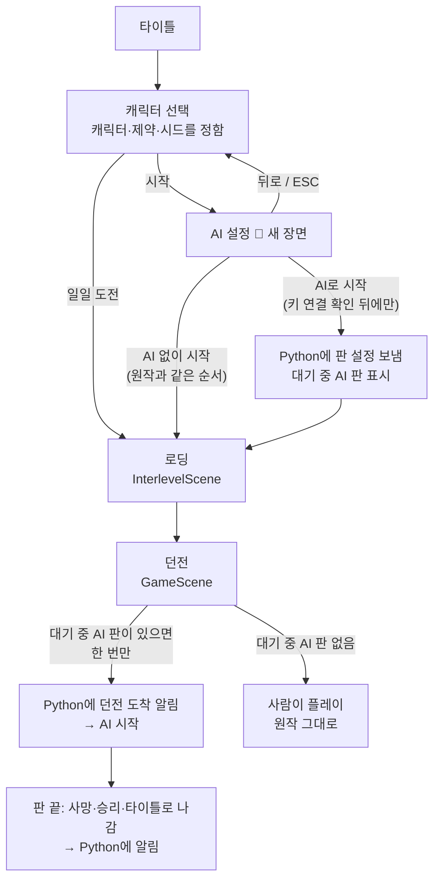

# 게임 ↔ Python 연결 설계 (AI 설정 장면)

> [A-5-1] 설계 문서. 이 문서대로 A-5-2부터 만든다.
> **A-5-2(AI 설정 장면, 값 기억만)는 만들었다** (10/31). 실제로 만든 것과 설계와 다른 점은 9장 "A-5-2 결과". Python 연결(A-5-3~)은 아직이다.

캐릭터 선택 화면 뒤에 게임 안 **"AI 설정" 장면**을 넣어, 게임에서 설정을 고르고 바로 AI 판을 시작하게 한다. 지금은 사람이 던전까지 들어간 뒤 관찰 패널에서 AI를 따로 시작한다.

**표기**
- ✅ 코드를 읽어서 확인한 것
- 💭 설계안 (아직 만들지 않음)
- ⬜ 미확인 (만들 때 확인해야 함)

---

## 0. 조사 결과 요약 (코드 읽기만)

경로는 `core/src/main/java/com/shatteredpixel/shatteredpixeldungeon/` 기준이다.

| # | 조사 항목 | 결과 |
|---|---|---|
| 1 | 캐릭터 선택의 시작 버튼 | ✅ `scenes/HeroSelectScene.java:150-164`. 순서: `selectedClass`가 없으면 무시 → `Dungeon.hero = null` → `Dungeon.daily = dailyReplay = false` → `Dungeon.initSeed()` → `ActionIndicator.clearAction()` → `InterlevelScene.mode = DESCEND` → `Game.switchScene(InterlevelScene.class)` |
| | 일일 도전 | ✅ 같은 화면의 일일 도전 버튼(`:752-758`)은 위 순서를 따로 실행해 바로 시작한다 |
| | 뒤로 가기 | ✅ `onBackPressed()`(`:557-563`)는 타이틀로 간다. `create()`가 `GamesInProgress.selectedClass`(static)를 다시 골라 주므로(`:391-392`) 다른 장면에서 돌아와도 고른 캐릭터가 남는다 |
| 2 | 캐릭터 | ✅ `GamesInProgress.selectedClass` (`HeroClass`) |
| | 제약(도전 모드) | ✅ `SPDSettings.challenges()` (9가지 비트 묶음, `Challenges.MASKS`·`NAME_IDS`). 판 시작 때 `Dungeon.init()`이 `Dungeon.challenges`로 복사(`Dungeon.java:236`) |
| | 시드 | ✅ `SPDSettings.customSeed()` (빈 글 = 무작위). 실제 시드는 `Dungeon.initSeed()`(`Dungeon.java:217-231`) 뒤의 `Dungeon.seed` |
| | 주의 | ✅ VICTORY 배지가 없고 디버그 실행이 아니면, 캐릭터 선택 화면이 제약·시드를 지운다(`HeroSelectScene.java:236-240`). `gradlew.bat desktop:debug`는 버전에 `INDEV`가 붙어 `DeviceCompat.isDebug()`가 참이라 지금 방식에서는 쓸 수 있다 |
| 3 | 던전 도착 | ✅ 로딩이 끝나면 `InterlevelScene.java:523`에서 `Game.switchScene(GameScene.class)`. `GameScene.create()`에서 `Dungeon.hero.next()`(`:612`) → 층 도착 메시지(`:626-629`) → `InterlevelScene.mode = NONE`(`:742`) → `fadeIn()`(`:779`) |
| | 주의 | ✅ `GameScene.create()`는 층을 옮기거나 이어하기를 할 때마다 불린다. "이번 판의 첫 도착"을 따로 구분해야 한다 (→ 3장) |
| | 주의 | ✅ 첫 판(`SPDSettings.intro()`)이면 튜토리얼이 툴바·상태창을 숨긴다(`GameScene.java:748-765`). ⬜ AI 첫 판에 주는 영향 |
| 4 | 가려서 입력 | ✅ `windows/WndTextInput`에는 가리기 옵션이 없다. 안쪽 `SPD-classes/.../noosa/TextInput.java`는 libGDX `TextField`를 `private`으로 들고 있어서 밖에서 켤 수 없다. libGDX `TextField`에는 `setPasswordMode`·`setPasswordCharacter`가 있다 → **`TextInput`에 메서드 하나를 더해야 한다** (게임 엔진 쪽 수정, A-5-2에서 합의) |
| | | ⬜ 가림 글자가 게임 글꼴로 그려지는지 (`TextInput.java:120`은 실제 입력 글자로 글꼴을 만든다), 데스크톱에서 Ctrl+V 붙여넣기 |
| 5 | 화면 글자 | ✅ `Messages.get(클래스, 키)`가 `assets/messages/scenes/scenes.properties`(영어 기본)와 `scenes_ko.properties`(한국어)에서 `scenes.<클래스 이름 소문자>.<키>`를 찾는다 (예: `scenes.heroselectscene.start=시작`). 한국어 파일에 없으면 영어 값이 나온다 |
| 6 | 지금 판 시작 흐름 | ✅ 사람이 던전까지 들어감 → 관찰 패널 `POST /api/console/start`(또는 설정 화면 `POST /api/start`) → `Agent(...)` → `config.json` |
| | `config.json` | ✅ player, model, model_name, guide, lessons_from, seed(관찰자가 적은 글, 게임과 연결 안 됨), steps, dry_run, demo, started_at, 첫 판단 뒤 display·game_window·ai_image |
| | 키 저장 | ✅ `/api/start`는 키와 함께 **`MODEL`도 `.env`에 쓴다** (`web.py`의 `set_key(ENV_PATH, "MODEL", ...)`). 4장 원칙과 다르다 (→ 8장) |
| 7 | 통로 재료 | ✅ 게임은 이미 libGDX `Gdx.net.sendHttpRequest`로 HTTP를 쓴다 (`services/news/.../ShatteredNews.java:54`). 결과는 다른 스레드에서 오므로 렌더 스레드로 넘겨야 한다. Python에는 `web.py`(Flask, 127.0.0.1:8765)가 이미 있다. Java 11 기준(`build.gradle:21`) |

---

## 1. 새 흐름도



- 💭 캐릭터 선택의 **시작** 버튼은 `initSeed()` 등을 하지 않고 AI 설정 장면으로 넘어가기만 한다. AI 설정 장면의 두 시작 버튼이 0장 1번의 순서를 그대로 실행한다. **AI 없이 시작**은 그 순서만 실행하므로 원작과 같다.
- 💭 **AI로 시작**은 같은 순서를 실행하기 전에 판 설정을 Python에 보내고 "대기 중 AI 판" 표시를 남긴다. 보내기가 실패하면 시작하지 않고 장면에 머물며 안내한다 (5장).
- 💭 **뒤로·ESC**는 캐릭터 선택으로 돌아간다. 캐릭터는 그대로 남는다 (✅ 0장 1번).
- 이번 범위 밖: **일일 도전**과 **이어하기**(저장된 판 불러오기)는 AI 설정을 거치지 않고 원작대로 동작한다.

---

## 2. AI 설정 장면 화면 구성

세로 360×640 창(배율 ×2, 게임 안 좌표 180×320) 기준이다. 💭 아래 그림은 배치안이고 실제 크기는 만들면서 맞춘다.

```
┌──────────────────────────────┐
│          AI 설정              │
│ 전사 · 제약 없음 · 시드 무작위  │ ← 읽기 전용 (캐릭터 선택에서 정함)
├─ 매번 보는 것 ────────────────┤
│ 모델   [ GPT-6 Luna      ▾ ] │
│ 공략   (●) 없이  ( ) 제공      │
│ API 키 ●●●●●●●●abcd           │
│        ✅ 연결됨 (12초 전)     │
│        [키 입력]  [연결 시험]  │
├─ 실험 옵션 ───────────────────┤
│ 판 방식 (●) 생각만 ( ) 실제 조작│
│ 최대 판단  [ 50 ]             │
│ 교훈 이어받기 [ 없음      ▾ ]  │
│ 플레이어   [ player    ]      │
├───────────────────────────────┤
│ [   AI로 시작   ] ← 연결 전 회색│
│ [  AI 없이 시작  ]             │
│ [ 뒤로 ]                      │
│ 안내: 키를 넣고 연결 시험을 …   │ ← 5장 문구가 나오는 자리
└──────────────────────────────┘
```

| 항목 | 내용 | 기본값 | 기억 |
|---|---|---|---|
| 캐릭터·제약·시드 | 읽기 전용 한 줄. 제약은 개수만 (예: "제약 2개") | – | – |
| 모델 | Python에서 받은 목록 (6장). 못 받으면 회색 | 지난번 값 | ✅ |
| 공략 | 없이 / 제공 | 없이 | ✅ |
| API 키 | 끝 4자리 + 상태 + [키 입력] [연결 시험] (4장) | – | **저장 안 함** |
| 판 방식 | 생각만 / 실제 조작. **실제 조작은 빨간 글자와 테두리**로 표시하고, [AI로 시작] 글자도 "AI로 시작 · 실제 조작"으로 바꾼다 | **생각만** | ✅ |
| 최대 판단 | 1~500 | 50 | ✅ |
| 교훈 이어받기 | Python에서 받은 교훈 목록. 못 받으면 "없음"만 | 없음 | ✅ (목록에 없으면 "없음") |
| 플레이어 | 기록 폴더 이름에 쓰는 이름 | player | ✅ |

- 💭 **[AI로 시작]이 눌리는 조건**: Python이 켜져 있음 + 고른 모델의 키 연결 시험이 성공함 (6장의 `key.tested_ok`). 설정을 바꿔서 회사가 달라지면 다시 회색이 된다.
- 💭 **[AI 없이 시작]과 [뒤로]는 언제나 눌린다.**
- 💭 **기억하는 곳**: 게임 설정(`SPDSettings`)에 `ai_model`, `ai_guide`, `ai_dry_run`, `ai_steps`, `ai_lessons_from`, `ai_player`로 저장한다. API 키는 어디에도 저장하지 않는다.
- 💭 판 방식을 기억하더라도, 지난번에 "실제 조작"이었으면 장면을 열 때 안내 줄에 "지난번 판은 실제 조작이었어요"를 한 번 보여 준다. 실수로 실제 조작 판을 시작하지 않게 하려는 것이다.

---

## 3. 게임 ↔ Python 약속

### 3-1. 주고받는 값

모두 JSON이다. 💭 주소는 `web.py`에 `/api/bridge/...`로 새로 만든다.

**① 상태 조회** `GET /api/bridge/status` (게임 → Python, 장면을 열 때와 3초마다)
```json
{
  "bridge_version": 1,
  "running": false,
  "models": [
    {"id": "gpt-6-luna", "name": "GPT-6 Luna", "provider": "openai"},
    {"id": "claude-haiku-4-5-20251001", "name": "Haiku 4.5", "provider": "anthropic"}
  ],
  "keys": {
    "openai":    {"present": true,  "last4": "abcd", "tested_ok": true,  "tested_at": "2026-11-02T14:03:11"},
    "anthropic": {"present": false, "last4": "",     "tested_ok": false, "tested_at": ""}
  },
  "lesson_sources": [
    {"run_id": "run_20261025_225713_live10", "label": "10/25 · GPT-6 Luna · 10판단"}
  ]
}
```

**② 키 보내기** `POST /api/bridge/key` (게임 → Python, [키 입력]에서 확인을 누를 때)
```json
요청 {"provider": "openai", "key": "sk-…(전체 키)"}
응답 {"ok": true, "last4": "abcd"}
```

**③ 연결 시험** `POST /api/bridge/test` (게임 → Python, [연결 시험])
```json
요청 {"model": "gpt-6-luna"}
응답 {"ok": false, "reason": "key_invalid", "message": "키가 맞지 않아요"}
```
`reason` 값: `ok`, `no_key`, `key_invalid`, `no_credit`, `model_unavailable`, `timeout`, `other`. 게임은 `reason`을 보고 5장의 문구를 고른다.

**④ 판 설정 확정** `POST /api/bridge/run` (게임 → Python, [AI로 시작])
```json
요청 {
  "player": "player", "model": "gpt-6-luna", "guide": false, "dry_run": true,
  "steps": 50, "lessons_from": "",
  "hero_class": "WARRIOR", "challenges": 0, "custom_seed": ""
}
응답 {"ok": true, "run_id": "run_20261102_140501_player"}
```
Python은 `Agent`를 만들어 두기만 하고 **아직 시작하지 않는다**. `config.json`도 이때 쓴다 (A-5-3).

**⑤ 던전 도착** `POST /api/bridge/arrived` (게임 → Python, 대기 중 AI 판이 있을 때 첫 `GameScene.create()` 한 번만)
```json
요청 {"run_id": "run_20261102_140501_player", "depth": 1, "seed_code": "ABC-DEF-GHI"}
응답 {"ok": true}
```
Python은 실제 시드를 **`config.json`에만** 더하고 AI를 시작한다 (A-5-4). 시드는 AI 입력에 넣지 않는다 (7장).

**⑥ 판 끝** `POST /api/bridge/ended` (게임 → Python)
```json
요청 {"run_id": "run_20261102_140501_player", "reason": "died", "depth": 3}
```
`reason`: `died`(✅ 후보 `Hero.die()`, `actors/hero/Hero.java:2171`), `won`(✅ 후보 `Dungeon.win()`, `Dungeon.java:880`), `quit`(✅ 후보 `WndGame`의 타이틀로 가기, `windows/WndGame.java:109`). ⬜ 어느 지점에 둘지는 A-5-4 뒤에 정한다.

### 3-2. 방향과 시점

| 시점 | 방향 | 내용 | 실패하면 |
|---|---|---|---|
| AI 설정 장면을 열 때, 그 뒤 3초마다 | 게임 → Python | ① 상태 조회 (Python→게임에 필요한 모델 목록·키 상태·시험 결과·교훈 목록을 이 응답으로 받음) | "Python이 꺼져 있어요" 안내, 모델·교훈 고르기 회색, [AI로 시작] 회색 |
| [키 입력] 확인 | 게임 → Python | ② 키 보내기 | 키는 버리고 안내 |
| [연결 시험] | 게임 → Python | ③ 연결 시험 (최대 30초) | 결과에 맞는 안내 |
| [AI로 시작] | 게임 → Python | ④ 판 설정 확정 | 시작하지 않고 장면에 머묾 |
| 던전 도착 (그 판의 첫 번째만) | 게임 → Python | ⑤ 던전 도착 | 게임은 그대로 진행, 화면 위에 "AI가 시작되지 않았어요" 한 줄 (⬜ 표시 방법) |
| 판 끝 | 게임 → Python | ⑥ 판 끝 | 무시 (Python 쪽은 기존 중지·최대 판단으로도 끝남) |

Python이 게임에 먼저 말을 거는 일은 없다. 게임이 물으면 Python이 답한다.

### 3-3. 통로 방식 비교

| 방식 | 구현 난이도 | 한쪽이 꺼져 있을 때 | 시험 방법 |
|---|---|---|---|
| **A. 파일** (게임이 `bridge/request.json`을 쓰고 Python이 읽음) | 쉬움. 대신 두 프로그램이 파일 위치를 같이 알아야 하고, 반쯤 쓴 파일 읽기·오래된 파일 지우기를 직접 처리 | 응답이 안 옴 → 기다릴 시간을 정해야 함. 꺼져 있는지 바로 알 수 없음 | 파일을 손으로 만들어 넣어 봄 |
| **B. 게임 → Python 로컬 HTTP** (`web.py`에 주소 추가) | 쉬움. 게임에 이미 `Gdx.net`(✅ 0장 7번), Python에 이미 Flask | 요청이 바로 실패 → "Python이 꺼져 있어요" 안내. 게임은 멈추지 않음 | `curl`로 Python 쪽만 따로 시험, 게임 없이 가능 |
| C. Python → 게임 로컬 HTTP (게임이 서버) | 어려움. 게임 안에 서버를 띄우고 받은 요청을 렌더 스레드로 넘겨야 함. 게임 코드 수정이 큼 | 게임이 꺼져 있으면 Python만 실패 | `curl`로 게임 쪽 시험 |
| D. 소켓 (TCP로 직접) | 중간~어려움. 메시지 경계·재연결을 직접 만들어야 함 | 연결 실패를 바로 앎. 끊김 처리를 직접 만들어야 함 | 시험용 도구를 따로 만들어야 함 |

**추천: B (게임이 Python의 `web.py`에 로컬 HTTP로 묻는다)**
- 두 쪽 모두 이미 있는 도구라 새 프로그램이 필요 없다.
- 게임 코드 수정이 가장 작다. 게임은 묻고 답만 받는다. 게임 규칙에 손대지 않는다.
- Python이 꺼져 있으면 요청이 바로 실패하므로 안내만 띄우면 된다. 게임은 멈추지 않는다.
- 게임 없이 `curl`로 Python 쪽을 먼저 만들고 시험할 수 있다.
- 💭 주소는 `http://127.0.0.1:8765` 고정. 바꿀 일이 생기면 실행 옵션으로 추가한다.
- 💭 **다른 웹사이트가 몰래 요청하지 못하게**: 브라우저에서 열린 아무 페이지나 `127.0.0.1:8765`에 요청을 보낼 수 있다. 그래서 `/api/bridge/*`는 `X-Nokpixel-Bridge: 1` 헤더가 있고 내용이 JSON인 요청만 받는다. 이 조합이면 브라우저는 먼저 허락을 묻고(사전 요청), Flask가 허락하지 않으므로 막힌다. (기존 `/api/start` 등도 같은 문제가 있다. 이번 범위 밖, 10장에 남김)

---

## 4. API 키 처리

| 원칙 | 방법 |
|---|---|
| 입력할 때 가린다 | 💭 `TextInput`에 가리기 메서드를 하나 더하고, 키 입력 창에서만 켠다 (0장 4번. ⬜ 가림 글자 표시, ⬜ Ctrl+V) |
| 게임은 저장하지 않는다 | 💭 입력받은 키는 ② 키 보내기에만 쓰고 바로 버린다. `SPDSettings`·저장 파일·게임 로그에 넣지 않는다. 입력 창에도 이전 키를 채워 두지 않는다 |
| Python이 `.env`에만 저장한다 | 💭 ②를 받으면 `ai-bridge/.env`에 `OPENAI_API_KEY` 또는 `ANTHROPIC_API_KEY` **한 줄만** 쓴다. 모델 등 다른 값은 쓰지 않는다 |
| 화면에는 끝 4자리와 시험 결과만 | 💭 Python은 `last4`만 돌려준다. 키 전체를 돌려주는 주소는 만들지 않는다 |
| 기록에 남지 않는다 | 💭 `config.json`·`log.jsonl`·`summary.txt`·관찰 패널 응답에 키가 들어가지 않는다. Flask 기본 접속 기록은 주소만 남기고 본문은 남기지 않는다 (⬜ 만들 때 실제 출력으로 확인). 오류 문구에 키가 섞이지 않게, 연결 시험 실패는 `reason`으로 바꿔서만 돌려준다 |
| 키가 지나가는 범위 | 같은 컴퓨터 안(127.0.0.1)에서만 지나간다. 암호화는 하지 않는다. 같은 컴퓨터의 다른 프로그램이 엿볼 수 있는 정도의 위험은 지금의 `.env` 파일과 같다 |

---

## 5. 안내 문구

원칙: 사용자가 **무엇을 하면 되는지** 말한다. "파일을 확인하세요" 같은 문장은 쓰지 않는다. **어떤 경우에도 게임은 멈추거나 꺼지지 않고, [AI 없이 시작]은 언제나 눌린다.**

| 상황 | 알아채는 방법 | 안내 문장 | 버튼 |
|---|---|---|---|
| Python이 꺼져 있음 | ① 요청이 바로 실패 | "AI 관찰기가 꺼져 있어요. `ai-bridge` 폴더에서 `python web.py`를 실행하면 자동으로 이어져요." | [다시 확인] [AI 없이 시작] |
| 키 없음 | ①의 `present: false` | "OpenAI API 키가 아직 없어요. [키 입력]을 눌러 붙여 넣어 주세요." (회사 이름은 고른 모델에 맞춤) | [키 입력] |
| 키 틀림 | ③ `key_invalid` | "키가 맞지 않아요. 키를 처음부터 끝까지 다시 복사해서 넣어 주세요." | [키 입력] [연결 시험] |
| 크레딧 부족 | ③ `no_credit` | "키는 맞지만 남은 크레딧이 없어요. 결제 페이지에서 충전한 뒤 [연결 시험]을 눌러 주세요." | [연결 시험] |
| 모델 사용 불가 | ③ `model_unavailable` | "이 키로는 GPT-6 Luna를 쓸 수 없어요. 다른 모델을 골라 주세요." | 모델 고르기로 이동 |
| 시간 초과 | ③ `timeout` | "AI 서버가 30초 안에 답하지 않았어요. 인터넷 연결을 본 뒤 [연결 시험]을 다시 눌러 주세요." | [연결 시험] |
| 연결 끊김 (장면에 있는 동안) | 3초마다 하는 ①이 실패 | "AI 관찰기와 연결이 끊겼어요. `python web.py` 창이 켜져 있는지 봐 주세요. 다시 켜지면 자동으로 이어져요." | [다시 확인] [AI 없이 시작] |
| [AI로 시작] 실패 | ④ 실패 | "AI 판을 준비하지 못했어요. 잠시 뒤 다시 눌러 주세요. 지금 바로 하려면 [AI 없이 시작]을 누르세요." | [AI로 시작] [AI 없이 시작] |
| 다른 판이 진행 중 | ①의 `running: true` | "관찰기에서 다른 판이 아직 진행 중이에요. 관찰 패널에서 중지한 뒤 시작해 주세요." | [다시 확인] |

💭 문장은 `scenes_ko.properties`에 한국어로, `scenes.properties`에 영어로 함께 넣는다 (0장 5번).

---

## 6. 모델 목록 한 곳에서 관리하기

**추천: Python(`ai-bridge/agent.py`의 `MODELS`)이 유일한 원본이고, 게임은 ① 상태 조회로 받아 온다.**
- AI 판을 돌리는 것은 Python이므로 Python이 아는 목록이 곧 쓸 수 있는 목록이다.
- 모델을 더하거나 뺄 때 Python 한 곳만 고치면 된다. 게임은 다시 빌드할 필요가 없다.
- Python이 꺼져 있으면 어차피 AI로 시작할 수 없으므로, 모델 고르기도 회색이면 된다. 지난번 고른 모델 이름은 회색 글자로 보여 준다.

| 대안 | 고르지 않은 이유 |
|---|---|
| 공용 JSON 파일(예: `ai-bridge/models.json`)을 게임과 Python이 각자 읽음 | 게임이 저장소 안 파일 위치를 알아야 한다 (실행 위치에 따라 달라짐). 게임 배포본에서는 깨진다 |
| Java와 Python에 같은 목록을 따로 적음 | 지금처럼 `DISPLAY_PRESETS`·`AI_WINDOW_PRESETS`를 두 곳에 두면, 한쪽만 고치는 실수가 생긴다 |

---

## 7. AI에게 주지 않을 정보

원칙: **플레이어 화면에 보이는 것만 준다.** (CLAUDE.md 5장)

| 값 | AI 입력에 | 이유 |
|---|---|---|
| 시드 (`custom_seed`, 실제 `seed_code`) | ❌ 넣지 않음. `config.json`에만 기록 | 시드는 맵을 미리 알게 해 주는 값이다. 사람도 게임 중에는 시드로 맵을 알 수 없다. 기록에는 같은 던전을 다시 만들려고 남긴다 |
| 캐릭터 (`hero_class`) | ✅ 넣음 (예: "직업: 전사") | 캐릭터 그림, 상태창의 초상화로 화면에 늘 보인다. 사람도 알고 시작한다 |
| 제약 (`challenges`) | ✅ 켜진 제약의 **이름만** 넣음 (예: "제약: 어둠 속으로"). 없으면 넣지 않음 | 게임 안 메뉴에서 플레이어가 언제든 볼 수 있다 (✅ `ui/MenuPane.java:133`, `windows/WndGame.java:70`). 규칙이 바뀌는데 모르면 사람보다 불리하다. 제약의 자세한 설명은 넣지 않는다 (공략에 가까움) |
| 공략 여부·교훈 | 지금과 같음 | 공략 제공·교훈 이어받기는 실험 조건으로 이미 따로 넣고 있다 |

💭 **실험 비교 주의**: README의 실험 조건은 "직업 전사, 도전 모드 끔"으로 고정이다. 캐릭터·제약 줄을 AI 입력에 더하면 프롬프트가 바뀌므로, 이 줄이 들어간 판과 이전 판은 조건이 다르다. 전사·제약 없음으로 고정할 거라면 이 줄을 넣지 않는 선택도 있다 (10장 남은 질문).

---

## 8. 관찰 패널과 역할 나누기

**설정의 주인은 게임 안 AI 설정 장면이다.** 관찰 패널은 읽기 전용으로 보여 주고, 판 진행 중에 필요한 것만 남긴다.

| 지금 패널에 있는 것 | 제안 |
|---|---|
| 실험 설정 칸 (플레이어, 모델, 생각만/실제, 최대 판단, 공략, 교훈, 시드) | 💭 **읽기 전용 요약**으로 바꾼다: "GPT-6 Luna · 공략 없이 · 생각만 · 50판단 · 전사 · 제약 없음 · 시드 ABC-DEF-GHI". 고치는 칸은 없앤다 |
| ▶ 시작 버튼 | 💭 없앤다. 그 자리에 "게임의 AI 설정에서 시작해요" 안내 |
| ■ 중지, ⊞ 창 배치, 게임 창 앞으로, 힌트 보내기, 기록 창 열기 | 그대로 둔다 (판 진행 중에 쓰는 것) |
| `/api/console/start` | 💭 ④ 판 설정 확정으로 대신하고 없앤다 |
| 설정 화면(`/`)과 `/api/start` | 💭 데모 모드(`--demo`)에서만 쓰는 시연용으로 남긴다. 실제 판에서는 게임에서 시작한다. `.env`에 `MODEL`을 쓰는 부분은 없앤다 (4장 원칙). ⬜ 이 정리는 A-5-3에서 사용자와 다시 정한다 |
| `mvp.py` (명령줄) | 그대로 둔다. 게임 밖에서 바로 시험할 때 쓴다 |

---

## 9. 다음 단계 범위

| 단계 | 하는 일 | 끝났다는 기준 |
|---|---|---|
| **A-5-2** AI 설정 장면 (값 저장만, 전달 없음) | 새 장면, 캐릭터 선택 → AI 설정 → 로딩 흐름, 두 묶음 화면, 가려서 키 입력, 값 기억(키 제외), 한국어·영어 문구 | `desktop:debug`에서 캐릭터 선택 → AI 설정 → [AI 없이 시작]이 원작과 같이 던전에 들어가고, [뒤로]·ESC로 캐릭터 선택에 돌아가며, 고른 값이 다음 실행에 남는다 (키는 남지 않는다) |
| **A-5-3** 값 전달 + `config.json` 자동 기록 | `web.py`의 `/api/bridge/*`(①~④), 게임의 HTTP 요청, 키 `.env` 저장, 연결 시험, 안내 문구, 관찰 패널 읽기 전용 | Python을 켜고 게임에서 키 입력·연결 시험·[AI로 시작]을 하면 `config.json`이 게임에서 고른 값으로 생기고, Python을 끈 상태에서도 게임이 멈추지 않고 [AI 없이 시작]이 된다 |
| **A-5-4** 던전 도착 신호 → AI 시작 | ⑤ 던전 도착(첫 도착만 구분), 실제 시드 기록, AI 판 자동 시작, ⑥ 판 끝 | [AI로 시작]만 누르면 던전 1층 도착 뒤 사람이 아무것도 누르지 않아도 AI가 첫 판단을 하고, 층을 옮겨도 AI 판이 새로 시작되지 않는다 |

### A-5-2 결과 (10/31)

**고친 게임 파일**
| 파일 | 내용 |
|---|---|
| `scenes/AISetupScene.java` (새 파일) | AI 설정 장면 |
| `scenes/HeroSelectScene.java` | [시작]은 AI 설정 장면으로 넘어가기만 한다. 원래 시작 순서 6줄은 [AI 없이 시작]으로 글자 그대로 옮겼다 |
| `SPDSettings.java` | `ai_model`, `ai_guide`, `ai_dry_run`, `ai_steps`, `ai_lessons_from`, `ai_player` 저장 (API 키 항목은 없음) |
| `SPD-classes/.../noosa/TextInput.java` | `setPasswordMode()` 추가. 가림 글자 `*`. 부르지 않으면 기존 입력 창은 그대로 |
| `messages/scenes/scenes.properties`, `scenes_ko.properties` | `scenes.aisetupscene.*` 문구 (영어·한국어) |

**확인한 것** (`desktop:debug`, 1920×1080 · 125% 배율 모니터)
- ✅ 캐릭터 선택 → AI 설정 → [AI 없이 시작] → 던전 1층
- ✅ 같은 시드(AAA-AAA-AAA, 제약 1개)로 바꾸기 전 빌드(`582834b`)와 1층 첫 화면을 비교: 지도가 같고, 다른 곳은 움직이는 그림(주인공·하수구)뿐
- ✅ [뒤로]·ESC → 캐릭터 선택. 캐릭터·제약·시드 그대로
- ✅ 일일 도전, 이어하기(저장 슬롯 → 계속)는 AI 설정 장면을 거치지 않는다
- ✅ 키 창: 가짜 키 17글자가 `*` 17개로 보임, Ctrl+V 붙여넣기 됨, 복사 버튼을 눌러도 클립보드에 키가 들어가지 않음. 시드 입력 창은 가려지지 않음
- ✅ 껐다 켜도 공략·판 방식·최대 판단·플레이어 값이 남음. `settings.xml`과 게임 데이터 폴더에 가짜 키 글자 없음
- ✅ 실제 조작: 빨간 글자·빨간 테두리, [AI로 시작] 글자 "AI로 시작 · 실제 조작". 다시 열면 "지난번 판은 실제 조작이었어요"
- ✅ 최대 판단 509 → 바꾸지 않고 안내. 플레이어 이름을 비우면 player
- ✅ 세로 3종(360×640 · 540×960 · 720×1280) 모두 잘리지 않음 → 실험 옵션 접기는 만들지 않았다
- ⬜ 키 창의 붙여넣기 **버튼** (Ctrl+V와 같은 함수를 쓰지만 직접 누르지는 않음)
- ⬜ 실제 1440·768 모니터 (1440 크기는 모니터보다 커서 창 내부 캡처로 확인)

**설계(2장)와 다른 점**
- 모델·교훈 이어받기는 펼침 목록 대신 **회색 버튼** 한 줄이다. 목록을 받을 곳(Python)이 아직 없어서 모델은 지난 값(없으면 "연결 후 고를 수 있어요"), 교훈은 "없음"만 보여 준다. `ai_model`·`ai_lessons_from`은 읽기만 하고 아직 쓰지 않는다.
- 공략·판 방식은 둘 중 하나를 고르는 동그라미 대신 **누를 때마다 바뀌는 버튼**이다.
- API 키 줄은 끝 4자리 대신 고정 문구 "AI 관찰기와 연결되면 확인할 수 있어요". [연결 시험]·[AI로 시작]은 언제나 회색.
- [뒤로]는 [AI 없이 시작] 오른쪽에 나란히 둔다.
- "지난번 판은 실제 조작" 안내는 다른 버튼을 하나 누르면 기본 안내로 돌아간다.
- 키 창은 확인을 누르면 입력한 글자를 어디에도 넘기지 않고 끝내고, 안내 줄에 "키 전달은 다음 단계에서 만들어요. 입력한 키는 저장하지 않고 버렸어요."를 보여 준다.
- 참고(원작 동작): 세로 화면의 캐릭터 선택은 4초 뒤 버튼이 흐려지며 눌리지 않는다. 화면을 한 번 누르면 다시 나타난다.

---

## 10. 남은 질문 · 미확인

**만들 때 정할 것**
- ~~`TextInput`(SPD-classes)에 가리기 메서드를 더하는 것~~ → A-5-2 오더에서 합의, `setPasswordMode()`로 만들었다.
- 캐릭터·제약 줄을 AI 입력에 넣을지 (7장 실험 비교 주의).
- 판 끝(⑥)을 알릴 지점: `Hero.die()` / `Dungeon.win()` / `WndGame`의 타이틀로 가기 중 어디에 둘지.
- 기존 `/api/start` 등에도 다른 웹사이트 요청 막기(3-3)를 적용할지.

**⬜ 미확인**
- ~~가림 글자가 게임 글꼴로 그려지는지, 데스크톱에서 Ctrl+V로 키를 붙여 넣을 수 있는지~~ → ✅ A-5-2에서 확인 (9장).
- 첫 판 튜토리얼(`SPDSettings.intro()`)이 AI 첫 판에 주는 영향.
- `Gdx.net` 요청이 실패할 때 걸리는 시간 (Python이 꺼져 있을 때 바로 실패하는지).
- Flask 접속 기록에 요청 본문(키)이 정말 남지 않는지.
- ~~세로 360×640(게임 안 180×320)에 이 항목이 모두 들어가는지~~ → ✅ 들어간다 (9장).
