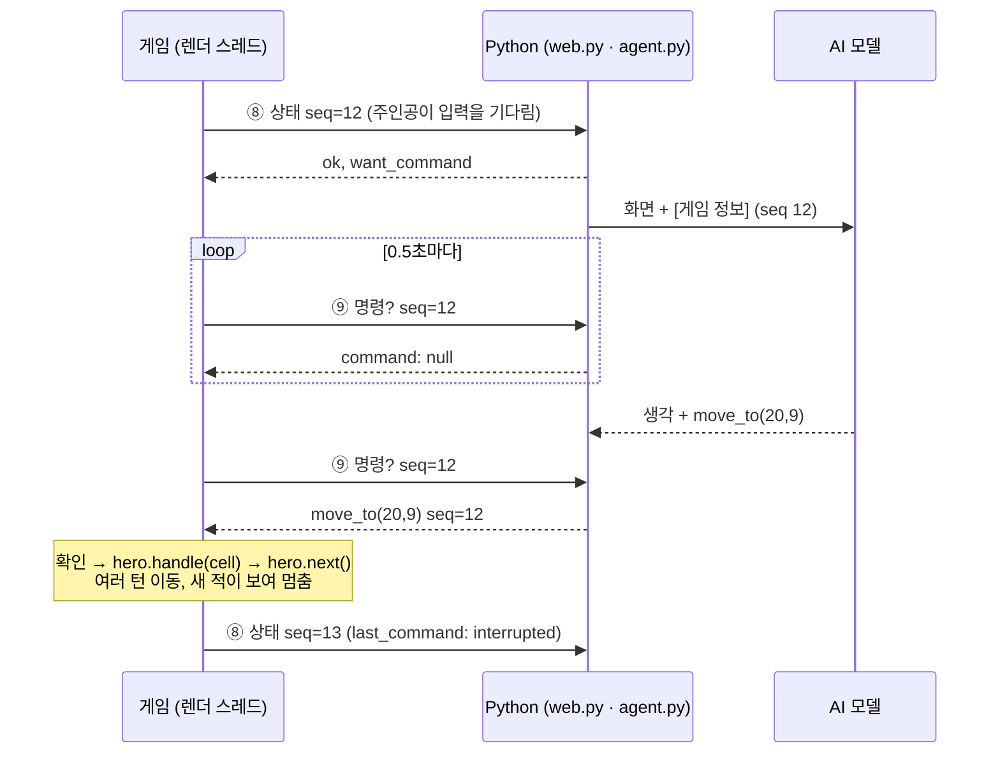

# 게임 데이터 전달 · 게임 함수 명령 설계

> [A-6-1] 설계 문서. 코드는 고치지 않았다. 이 문서대로 A-6-2부터 만든다.

지금 AI는 게임 화면 사진만 보고 키를 눌러 한 칸씩 움직인다. 11/2 실제 판(`run_20261102_182004_player`)에서 AI는 1층 입구(올라가는 계단)를 출구로 알고 거듭 밟았고, 가 본 곳을 기억하지 못했고, 판단 한 번에 1~3칸만 움직였다 (`docs/test-results/test-results-2026-11-02.txt` 6장).
그래서 AI가 **화면에 보이는 것과 같은 범위의 게임 데이터**를 함께 받고, **게임 함수로 목적 단위 명령**("(12,7)까지 가기", "체력이 찰 때까지 쉬기")을 내리게 한다.

**표기**
- ✅ 코드를 읽어서 확인한 것
- 💭 설계안 (아직 만들지 않음)
- ⬜ 미확인 (만들 때 확인해야 함)

경로는 `core/src/main/java/com/shatteredpixel/shatteredpixeldungeon/` 기준이다.

**용어**
- 렌더 스레드: 화면을 그리는 흐름. 게임 장면의 `update()`가 여기서 돈다.
- 액터 스레드(actor thread): 주인공과 적이 차례대로 행동하는 흐름. 주인공이 입력을 기다리면 멈춰 있다.
- FOV(field of view): 지금 주인공 눈에 보이는 칸.

---

## 0. 조사 결과 요약 (코드 읽기만)

| # | 조사 항목 | 결과 |
|---|---|---|
| 1 | 주인공 상태 | ✅ 층 `Dungeon.depth`, 체력 `hero.HP`/`HT`, 레벨 `hero.lvl`, 경험치 `hero.exp`/`maxExp()`, 힘 `hero.STR()`, 금화 `Dungeon.gold`. 모두 상태창·주인공 정보 창에 보인다 |
| | 배고픔 | ✅ 숫자(`Hunger.level`, private)는 화면에 없다. 화면에는 **아이콘만** 나온다: 300 미만이면 없음, 300 이상 "배고픔", 450 이상 "굶주림" (`actors/buffs/Hunger.java:178` `icon()`) → 단계만 넘긴다 |
| | 상태이상 | ✅ `hero.buffs()` 중 `icon() != BuffIndicator.NONE`인 것만 화면 아이콘으로 보인다 (`Buff.java:94`). 이름은 `Buff.name()` (`:127`) |
| | 서 있는 칸 | ✅ `Dungeon.level.tileName(map[hero.pos])` (`levels/Level.java:1579`) |
| 2 | 시야 | ✅ `Level.heroFOV`(지금 보임), `Level.visited`(한 번이라도 봄), `Level.mapped`(지도 주문서 등으로 밝혀짐) (`Level.java:154-160`). `Dungeon.observe()`가 지금 보이는 칸을 `visited`에 더하고, 주변 8칸은 보지 않아도 `visited`로 만든다 (`Dungeon.java:908-938`). 칸 번호 = `x + y × width()` |
| 3 | 적·아이템·계단·문 | ✅ 사람이 칸을 길게 눌러 살펴볼 때 쓰는 `GameScene.getObjectsAtCell()` (`scenes/GameScene.java:1784`)이 "화면에서 알 수 있는 것"의 기준이다. 적은 `heroFOV[cell]`일 때만, 바닥 더미는 `heap.seen`일 때만(한 번 보면 시야 밖에서도 그림이 남음, `sprites/ItemSprite.java:110`), 함정은 `trap.visible`일 때만 |
| | 이름 | ✅ 적 `Mob.name()`, 바닥 더미 `Heap.title()`(`items/Heap.java:371`, 상자·무덤 등은 종류 이름), 함정 `Trap.name()`, 식물 `Plant.name()`. 이름 고르기는 `GameScene.getObjectNames()`(`:1810`)와 같다 |
| | 계단 | ✅ `Level.transitions`, 칸으로 찾기 `getTransition(cell)` (`Level.java:584`). 종류 `LevelTransition.Type`: `REGULAR_ENTRANCE`(올라감), `REGULAR_EXIT`(내려감), `SURFACE`, `BRANCH_*` |
| | 잠든 적 | ✅ 잠든 적은 머리 위 Zz로 보인다 (`sprites/CharSprite.java:637`). 그 밖의 적 상태(쫓는 중·돌아다님)는 화면 글자로 나오지 않는다 |
| 4 | 가방 | ✅ `hero.belongings`: 장착 `weapon`·`armor`·`artifact`·`misc`·`ring`(`actors/hero/Belongings.java:82-86`) + `backpack`. 화면 이름은 `Item.title()`(`items/Item.java:485`) → `name()`. 미감정 물약·주문서·반지는 `name()`이 겉모습 이름을 돌려준다 (`items/potions/Potion.java:378`, `scrolls/Scroll.java:240`, `rings/Ring.java:172`). 강화 수치는 `visiblyUpgraded()`(`Item.java:435`, 수치를 알 때만), 저주는 `visiblyCursed()`(`:443`) |
| 5 | 메시지 기록창 | ✅ 게임 메시지는 `GLog.update`(신호)로 퍼진다. 앞에 붙는 기호로 종류를 안다: `++` 좋음, `--` 나쁨, `**` 경고, `@@` 강조 (`utils/GLog.java`). 화면의 `GameLog`는 만들어질 때 `GLog.update.replace(this)`로 **다른 듣는 쪽을 모두 지운다** (`ui/GameLog.java:47`). 화면에는 최근 3줄만 보인다 |
| 6 | 숨길 것 | ✅ `Terrain.SECRET` 표시가 붙은 지형은 둘: `SECRET_DOOR`(벽 그림, 이름 "벽"), `SECRET_TRAP`(바닥 그림, 이름 "바닥") (`levels/Terrain.java:46-47`, `tiles/DungeonTileSheet.java:431,470`, `Level.tileName()`). 발견하면 `Terrain.discover()`로 `DOOR`·`TRAP`이 된다. 미믹은 정체를 드러내기 전(`alignment == NEUTRAL`) `name()`이 "상자"다 (`actors/mobs/Mimic.java:112`) |
| 7 | 행동 | ✅ 칸 누르기: `GameScene`의 기본 셀 리스너가 `if (hero.handle(cell)) hero.next();` (`GameScene.java:1846-1852`). `Hero.handle()`(`actors/hero/Hero.java:1920`)이 칸에 따라 공격·대화·줍기·상자 열기·잠긴 문 열기·계단·이동 중 하나를 고른다 |
| | 이동 길찾기 | ✅ 먼 칸으로 가는 길은 **본 칸(`visited`·`mapped`)만** 지나간다 (`Hero.getCloser()`, `Hero.java:1808` 아래). 한 번의 이동 명령으로 도착할 때까지 여러 칸 간다 |
| | 쉬기·탐색 | ✅ 툴바 버튼과 같은 호출: 한 턴 `hero.rest(false)`, 체력이 찰 때까지 `hero.rest(true)`, 탐색 `hero.search(true)` (`ui/Toolbar.java:203-313`) |
| | 아이템 | ✅ 아이템 창 버튼은 `item.execute(Dungeon.hero, action)` (`windows/WndUseItem.java:62`). 행동 목록 `item.actions(hero)`, 행동 이름 `actionName()`. 던지기 등은 칸 고르기가 이어서 뜨고, 그 칸은 `GameScene.handleCell(cell)`(`:1640`)로 고를 수 있다 |
| 8 | 끝난 때 | ✅ 주인공이 다음 입력을 기다리면 `Hero.ready()`(private, `:937`)가 `hero.ready = true`와 `GameScene.ready()`를 한다. 이때 액터 스레드는 `Actor.process()`에서 기다리며 멈춰 있다 (`actors/Actor.java:309-325`) → 이 순간 읽은 데이터는 바뀌지 않는다 |
| | 끊김 | ✅ `Hero.interrupt()`(`:985`)가 하던 일을 지운다. 이동이 덜 끝났으면 `lastAction`에 남긴다 (게임의 "이어 가기" `resume()`). 새 적이 보이면 `checkVisibleMobs()`(`:1715`)가 `interrupt()`를 부른다 |
| | 창 | ✅ 창이 떠 있거나 가방에서 고르는 중이면 `GameScene.interfaceBlockingHero()`(`:1471`)가 참 |
| + | 이정표 재료 | ✅ `Statistics.enemiesSlain`, `deepestFloor`, `upgradesUsed`, `itemTypesDiscovered` (`Statistics.java`), `hero.lvl`. 구 처치는 `Goo.die()`(`actors/mobs/Goo.java:283`) → `GameScene.bossSlain()`(`GameScene.java:1630`) |
| + | Python 쪽 | ✅ AI 입력 = 규칙(`SYSTEM_PROMPT`, `ai-bridge/agent.py:90`) + 판단 요청 글(`_prompt_text()`) + 화면 이미지. 도구는 `press_keys`, `click` (`agent.py:133`) |

**게임 코드를 고치지 않고 읽을 수 있다.** 위 값은 모두 `public`이거나 `public` 함수로 읽힌다. 💭 A-6-2부터 읽기·숨기기는 새 파일(예: `GameState.java`)에, 통로는 기존 `AIBridge.java`에 둔다. `GameScene`에는 이미 `AIBridge.onGameUpdate()` 한 줄이 있다 (렌더 스레드). `Hero`·`Level`·`GameScene.getObjectsAtCell()`(private)은 고치지 않고, 같은 조건을 새 파일에 다시 쓴다.

---

## 1. AI에게 넘길 데이터 (3-1)

### 1-1. 항목별 표

"화면" 칸: 플레이어가 화면(상태창, 칸 살펴보기, 가방, 주인공 정보 창)에서 알 수 있는가.

| 묶음 | 값 | 가져오는 코드 | 화면 | 넘기나 |
|---|---|---|---|---|
| 주인공 | 층 | `Dungeon.depth` | ✅ 상태창 | 💭 넘김 |
| | 체력 / 최대 체력 | `hero.HP`, `hero.HT` | ✅ 상태창 | 💭 넘김 |
| | 레벨, 경험치 | `hero.lvl`, `hero.exp`, `hero.maxExp()` | ✅ 상태창·정보 창 | 💭 넘김 |
| | 힘 | `hero.STR()` | ✅ 정보 창 | 💭 넘김 |
| | 금화 | `Dungeon.gold` | ✅ 가방 | 💭 넘김 |
| | 배고픔 | `Hunger.icon()` → 없음 / 배고픔 / 굶주림 | ✅ 아이콘만 | 💭 **단계만** (숫자 안 넘김) |
| | 상태이상 | `hero.buffs()` 중 `icon() != NONE`의 `name()` | ✅ 아이콘 (누르면 이름) | 💭 이름만. 남은 턴 수는 넘기지 않음 (⬜ 아이콘 글자로 보이는 버프가 있는지) |
| | 위치, 서 있는 칸 | `hero.pos` → (x, y), `level.tileName(map[pos])` | ✅ | 💭 넘김 |
| 지도 | 지금 보이는 칸 | `level.heroFOV` | ✅ 밝게 | 💭 문자 지도 (1-4) |
| | 본 적 있는 칸 | `level.visited`, `level.mapped` | ✅ 어둡게 | 💭 문자 지도 |
| | 본 적 없는 칸 | 둘 다 거짓 | ❌ 검정 | **넘기지 않음** (빈칸) |
| 적 | 시야 안 적: 위치·이름·잠듦·체력 비율 | `level.mobs` 중 `heroFOV[m.pos]`, `m.name()`, `m.state == m.SLEEPING`, `HP/HT` | ✅ 그림, Zz, 살펴보기 창의 체력 막대 | 💭 넘김. 체력은 막대처럼 **4단계 비율**만 (⬜ 막대 보이는 정밀도) |
| | 시야 밖 적 | | ❌ | **넘기지 않음** |
| 바닥 | 본 적 있는 더미: 위치·이름 | `level.heaps` 중 `heap.seen`, `heap.title()` | ✅ 그림이 남음 | 💭 넘김 (지금 보이는지 여부도) |
| | 보이는 함정 | `level.traps` 중 `trap.visible`, `trap.name()` | ✅ | 💭 넘김 |
| | 식물 | `level.plants` 중 본 칸, `plant.name()` | ✅ | 💭 넘김 |
| 계단·문 | 본 칸의 계단 | `level.getTransition(cell)` + 그 칸이 본 칸 | ✅ | 💭 넘김. 게임의 이름(`tileName`) 그대로와 **올라가는 계단 / 내려가는 계단** 구분만 준다. 우리가 지은 설명(예: "1층 입구는 나갈 수 없음")은 붙이지 않는다 — 힌트가 되어, AI가 나아진 이유가 데이터 때문인지 힌트 때문인지 구분할 수 없게 된다 (A-6-2 오더) |
| | 본 칸의 문 | `map[cell]`이 `DOOR`·`OPEN_DOOR`·`LOCKED_DOOR` 등 | ✅ | 💭 넘김 (지도 기호) |
| 가방 | 장착 5칸, 가방 안 아이템 | `belongings` | ✅ 가방 창 | 💭 `title()`과 번호만 (1-2) |
| | 아이템의 행동 목록 | `item.actions(hero)`, `actionName()` | ✅ 아이템 창 버튼 | 💭 넘김 (명령에 씀) |
| | 단축 슬롯 | `Dungeon.quickslot` (⬜ 확인) | ✅ | 💭 화면만 판과 맞추려면 넘김 |
| 메시지 | 최근 게임 메시지 | `GLog.update`에 듣는 쪽을 더함 | ✅ 기록창 3줄 | 💭 마지막 판단 뒤에 나온 글 (최대 8줄, 기호 → [좋음] [나쁨] [경고]) |
| 판단 이유 | 왜 지금 묻는가 | 게임이 판단 요청을 보낼 때 정함 (3장) | – | 💭 넘김 (`reason`) |
| 기록 전용 | 통계·보스 상태 | `Statistics.*`, 구의 생존 | 일부만 | **AI 입력에 넣지 않음.** 이정표 기록에만 (6장) |

### 1-2. 예시 데이터 (JSON) 💭

게임이 Python에 보내는 모양이다. `ai` 부분만 AI 입력 글로 바뀐다. `record` 부분은 Python 기록에만 쓴다.

```json
{
  "state_version": 1,
  "run_id": "run_20261105_140501_player",
  "seq": 12,
  "reason": "interrupted_enemy",
  "last_command": {"seq": 11, "name": "move_to", "args": {"x": 20, "y": 9},
                   "outcome": "interrupted", "from": [14, 9], "to": [17, 9]},
  "ai": {
    "hero": {"depth": 1, "hp": 14, "ht": 20, "lvl": 1, "exp": 3, "exp_next": 10,
             "str": 10, "gold": 23, "hunger": "none", "buffs": [],
             "pos": [17, 9], "standing_on": "바닥"},
    "map": {"origin": [8, 2], "width": 18, "height": 14,
            "rows": ["…문자 지도 한 줄씩 (1-4)…"]},
    "mobs": [{"id": 1, "name": "시궁쥐", "pos": [20, 9], "asleep": false, "hp": "3/4"}],
    "heaps": [{"name": "주황색 물약", "pos": [11, 4], "visible_now": false},
              {"name": "상자", "pos": [15, 12], "visible_now": true}],
    "transitions": [{"kind": "up", "name": "던전 입구", "pos": [10, 3]}],
    "traps": [], "plants": [],
    "bag": {
      "equipped": {"weapon": "낡은 단검", "armor": "천 갑옷", "artifact": null, "misc": null, "ring": null},
      "items": [{"id": 1, "name": "음식", "actions": ["먹기", "던지기", "버리기"]},
                {"id": 2, "name": "주황색 물약", "actions": ["마시기", "던지기", "버리기"]}]
    },
    "log": [{"kind": "normal", "text": "시궁쥐가 나타났다."}]
  },
  "record": {"enemies_slain": 0, "deepest_floor": 1, "upgrades_used": 0,
             "boss": null}
}
```

- 이름은 게임 언어 그대로다 (한국어 게임이면 한국어). 위 이름은 예시다. ⬜ 실제 한국어 이름.
- 아이템 `id`는 그 상태(`seq`) 안에서만 쓰는 번호다. 명령에 `seq`를 함께 보내서, 가방이 바뀐 뒤 옛 번호로 다른 아이템을 쓰는 일을 막는다 (3장).
- 💭 크기: 18×14 지도 + 목록이면 수 KB. ⬜ 큰 층에서의 실제 크기.

### 1-3. AI 입력에 들어갈 글 모양 💭

"화면 + 데이터" 판에서만, `[현재 중간 목표]`·`[기억 메모]` 뒤, `[현재 게임 화면]` 이미지 앞에 붙인다.

```
[게임 정보] (판단 12 · 이번에 멈춘 이유: 새 적이 보임)
지난 명령: (20,9)까지 가기 → 중간에 멈춤 (14,9)→(17,9)
나: 1층 · 체력 14/20 · 레벨 1 (경험치 3/10) · 힘 10 · 금화 23 · 배고픔 없음 · 상태이상 없음
위치 (17,9), 발밑: 바닥

[지도] 본 칸만. 빈칸 = 아직 모름. 좌표는 (x,y)
     8   12   16   20   24
 2   ##########
 3   #.<....+.#
 4   #..*.....#     ######
 5   #........'''''''.....#
 ...
 9   #......@..1..........#
(기호: @ 나, 1~9 적, # 벽, . 바닥, + 닫힌 문, ' 열린 문, < 올라가는 계단, > 내려가는 계단, * 아이템 …)

보이는 적: 1 시궁쥐 (20,9) 깨어 있음, 체력 3/4
아이템: 주황색 물약 (11,4) · 상자 (15,12)
계단: 올라가는 계단 < (10,3) 던전 입구 · 본 칸 중 내려가는 계단: 없음
가방: [장착] 낡은 단검, 천 갑옷 / 1 음식 (먹기·던지기·버리기) / 2 주황색 물약 (마시기·던지기·버리기)
최근 메시지: 시궁쥐가 나타났다.
```

- 💭 "본 칸 중 내려가는 계단: 없음"처럼 **사실만** 쓴다. 해석("아직 못 찾음", "찾아야 함")은 붙이지 않는다. 출구가 어디 있는지는 쓰지 않는다. 계단 이름은 게임 이름 그대로다 (위 이름은 예시, ⬜ 실제 한국어 이름).
- 💭 AI 판단 기록(`log.jsonl`)에는 이 글을 통째로 넣지 않고, 상태 파일(`states/0012.json`)로 따로 저장하고 판단에 `state_seq`만 남긴다 (5장). 기록 창에서 그때 데이터를 볼 수 있게 한다.

### 1-4. 가 본 곳의 문자 지도 💭

| 기호 | 뜻 | 지형 (`Terrain`) |
|---|---|---|
| (빈칸) | 아직 모름 | `visited`·`mapped` 둘 다 거짓 |
| `@` | 나 | `hero.pos` |
| `1`~`9` | 지금 보이는 적 (목록 번호와 같음, 10마리 넘으면 `M`) | `heroFOV` 안의 적 |
| `#` | 벽 (숨겨진 문 포함) | `WALL`, `WALL_DECO`, `SECRET_DOOR` |
| `.` | 바닥 (숨겨진 함정 포함) | `EMPTY`, `EMPTY_SP`, `EMPTY_DECO`, `SECRET_TRAP`, `INACTIVE_TRAP`, `EMBERS` 등 지나갈 수 있는 바닥 |
| `+` | 닫힌 문 | `DOOR` |
| `'` | 열린 문 | `OPEN_DOOR` |
| `L` | 잠긴 문·잠긴 출구 | `LOCKED_DOOR`, `HERO_LKD_DR`, `CRYSTAL_DOOR`, `LOCKED_EXIT` |
| `<` | 올라가는 계단 (입구) | 이동 지점 종류 `REGULAR_ENTRANCE`·`SURFACE` |
| `>` | 내려가는 계단 (출구) | `REGULAR_EXIT` (지형 `EXIT`·`UNLOCKED_EXIT`) |
| `~` | 물 | `WATER` |
| `,` | 풀 | `GRASS` |
| `"` | 높은 풀 (시야를 막음) | `HIGH_GRASS`, `FURROWED_GRASS` |
| `:` | 낭떠러지 | `CHASM` |
| `^` | 보이는 함정 | `TRAP` (`trap.visible`) |
| `T` | 조각상·장식·책장 등 막힌 것 | `STATUE`, `BOOKSHELF`, `BARRICADE`, `REGION_DECO` 등 |
| `0` | 우물·연금 솥 | `WELL`, `EMPTY_WELL`, `ALCHEMY` |
| `*` | 바닥 아이템 (상자 포함) | `heap.seen` |
| `?` | 위 표에 없는 지형 | 만들 때 표에 더한다 |

- **크기**: 층 전체가 아니라 **본 칸을 모두 담는 가장 작은 네모**만 보낸다. 위쪽에 x 눈금(5칸마다), 왼쪽에 y 숫자. 좌표는 게임 칸 좌표 그대로(0부터) 쓰고 `origin`으로 네모의 왼쪽 위를 알린다. ⬜ 층 크기(층마다 다름, 하수도는 대략 수십 칸)와 글자 수.
- **겹칠 때 우선순위**: `@` > 적 > `*` > `^` > 지형.
- **지금 보이는지**: 지형은 화면처럼 기억 그대로 그린다(화면도 안개 속 지형을 어둡게 보여 준다). 적은 지금 보이는 것만 그린다. 아이템은 목록에 "지금 보임"인지를 적는다.
- 1층 입구도 다른 올라가는 계단처럼 `<`로 그린다. 따로 설명을 붙이지 않는다.
- ⬜ 시야 밖에서 바뀐 지형(불에 탄 문 등)이 화면에 바로 반영되는지. 화면과 다르면 화면 쪽을 따른다(바뀐 칸은 다시 볼 때까지 옛 지형으로 보내는 안).

---

## 2. 숨기는 정보 (3-2)

원칙은 [decision-points.md](decision-points.md) C그룹과 CLAUDE.md 5장과 같다: **플레이어 화면에 보이는 것만 준다.** 💭 걸러 내기는 Python이 아니라 **게임 안 한 곳**(`GameState`)에서 한다. 숨길 값은 아예 게임 밖으로 보내지 않는다.

| 숨길 것 | 어느 코드 | 어떻게 걸러 내나 💭 |
|---|---|---|
| 안 본 칸 | `level.map` 전체 | `visited[cell] || mapped[cell]`인 칸만 지도에 쓴다. 나머지는 빈칸 |
| 숨겨진 문 | `Terrain.SECRET_DOOR`, `Terrain.flags[..] & SECRET` | **겉모습 지형으로 바꿔서** 쓴다: `SECRET_DOOR` → 벽 `#`, `SECRET_TRAP` → 바닥 `.`. 표의 기호는 지형 번호가 아니라 이 바꾼 값으로 고른다 |
| 숨겨진 함정 | `SECRET_TRAP`, `level.traps`의 `trap.visible == false` | 지도는 위처럼 바닥. 함정 목록에는 `trap.visible`인 것만 |
| 시야 밖 적, 층의 적 수 | `level.mobs` | `heroFOV[m.pos]`인 적만. 적 수 합계도 보내지 않음 |
| 미믹 | `Mimic`의 `alignment == NEUTRAL` | 적 목록에 넣지 않고 아이템 목록에 "상자"로 넣는다 (이름은 `name()` 그대로 "상자"). 지도에도 `*` |
| 바닥 아이템 전체 | `level.heaps` | `heap.seen`인 것만. 이름은 `heap.title()`만 |
| 계단 위치 | `level.transitions`, `entrance()`, `exit()` | 계단 칸이 본 칸일 때만. `exit()` 같은 함수로 위치를 미리 구하지 않는다 |
| 미감정 아이템의 정체 | 클래스 이름, `trueName()`, `isKnown()`, `isIdentified()` | **이름은 `title()`만** 쓴다. `getClass()`, `trueName()`을 부르는 코드를 `GameState`에 두지 않는다. 강화 수치는 `title()`에 들어 있을 때만(=`visiblyUpgraded()`), 저주는 `visiblyCursed()`일 때만 "저주받음" |
| 배고픔 숫자 | `Hunger.level` | 아이콘 단계만 |
| 적 체력 숫자 | `m.HP` | 4단계 비율만 (체력 막대 수준) |
| 몬스터 드롭, 적 AI 상태 | `Mob.loot`, `m.state` | 잠듦(Zz)만 넘기고 나머지는 넘기지 않음 |
| 시드 | `Dungeon.seed` | 보내지 않음. `config.json`의 `seed_code`는 지금처럼 Python 기록에만 (bridge.md 7장) |
| 이정표용 통계 | `Statistics.*`, 보스 생존 | `record` 칸으로만 보낸다. Python은 `record`를 AI 입력 글에 넣지 않는다 |

⬜ 미확인: 투명해진 적이 시야 안에서 화면에 보이는지(`sprite.visible`과 함께 보는 안), 숨은 미믹(`MimicTooth.stealthyMimics()`), 마음의 눈(`MindVision`)으로 벽 너머 적이 보일 때 — 이때는 `heroFOV`가 그 칸을 참으로 만든다(`Dungeon.java:942-953`, ✅) → 화면에도 보이므로 넘겨도 된다.

### 2-1. 걸러 내기가 잘못됐는지 시험하는 방법 💭

| 시험 | 방법 | 통과 기준 |
|---|---|---|
| 숨겨진 문 | 디버그 실행에서 숨겨진 문이 있는 층을 찾는다(시드를 고정해 몇 층 돌려 봄. 게임의 "비밀이 있는 층" 표시 `Level.Feeling.SECRETS`가 단서). 그 칸 좌표를 **시험용 콘솔 출력**으로만 확인 | 상태 데이터에서 그 칸이 `#`. 탐색으로 찾은 뒤에는 `+` |
| 숨겨진 함정 | 같은 방법 | 찾기 전 `.`, 함정 목록에 없음. 찾은 뒤 `^` |
| 안 본 칸 | 층에 막 들어왔을 때의 상태 | 지도 네모가 처음 시야 크기 정도. 계단이 시야 밖이면 계단 목록이 비어 있음 |
| 미감정 물약 | 시작 직후 물약을 주움 | 이름이 색 이름. 상태 파일 전체에 `PotionOf`, `Healing`, 진짜 이름이 없다 (글자 검색) |
| 시드 | 상태 파일 전체 | `seed_code`의 글자(예: `XQW-TMQ-ZDW`)와 시드 숫자가 없다 |
| 클래스 이름 | 상태 파일 전체 | `com.shatteredpixel`, `Potion`, `Scroll`, `Ring` 같은 영어 클래스 이름이 없다 |
| 시야 밖 적 | 적이 보이다가 문 뒤로 사라짐 | 다음 상태에서 적 목록에서 빠짐 |
| 미믹 | ⬜ 미믹이 나오는 층을 만나면 | 정체가 드러나기 전 "상자", 아이템 목록에 있음 |

- 💭 글자 검색 시험은 Python 쪽 작은 검사 스크립트로 만든다: `logs/<판>/states/*.json`에서 금지 글자(클래스 이름 목록, 시드)를 찾는다. 판이 끝날 때마다 돌릴 수 있다.
- 💭 같은 시드로 "화면만" 판과 "데이터" 판을 한 번씩 열어, 같은 위치에서 화면 스크린샷과 문자 지도를 사람이 나란히 비교한다 (모르는 칸이 화면에서도 검정인지).

---

## 3. AI가 쓸 명령 (3-3)

### 3-1. 명령 목록 💭

모든 명령은 게임 안 렌더 스레드에서, 주인공이 입력을 기다릴 때만 실행한다 (CLAUDE.md 5장). 좌표는 게임 칸 좌표 (x, y).

| 이름 | 인자 | 게임에서 하는 일 | 사람 조작과 같은 경로인가 |
|---|---|---|---|
| `move_to` | x, y | `hero.handle(cell)` → `hero.next()`. 본 칸으로만 길을 찾아 도착할 때까지 간다 | ✅ 칸 누르기와 같음 |
| `attack` | x, y | 위와 같음. 그 칸에 **지금 보이는 적**이 있을 때만 | ✅ 적 칸 누르기 |
| `pick_up` | (없음 = 발밑) 또는 x, y | 위와 같음. 그 칸에 본 아이템이 있을 때만. 상자면 연다 | ✅ 칸 누르기. 발밑은 툴바 "기다리기/줍기"와 같은 결과 |
| `take_stairs` | x, y | 위와 같음. 그 칸이 본 계단일 때만. 1층 입구면 실행하지 않고 `cannot_leave` | ✅ 계단 칸 누르기 |
| `rest` | until: `turn` / `full` | `hero.rest(false)` 한 턴, `hero.rest(true)` 체력이 찰 때까지 | ✅ 툴바 버튼과 같음 |
| `search` | (없음) | `hero.search(true)` | ✅ 툴바 탐색과 같음 |
| `use_item` | seq, item_id, action | `item.execute(hero, action)`. 행동 이름은 그 아이템의 `actions()` 중 하나 | ✅ 아이템 창 버튼과 같음 |
| `throw_item` | seq, item_id, x, y | `execute(hero, THROW)` → 칸 고르기가 뜨면 `GameScene.handleCell(cell)` | ✅ 던지기 뒤 칸 누르기와 같음 (⬜ 다른 아이템의 칸 고르기도 같은지) |
| `resume` | (없음) | `hero.resume()` (끊긴 이동을 이어 감) | ✅ 게임의 "이어 가기" 표시와 같음 (⬜ 버튼이 보일 때만 허락) |

- `move_to`·`attack`·`pick_up`·`take_stairs`는 게임 안에서 모두 같은 `handle(cell)`이다. 그래도 이름을 나누는 이유: AI의 **의도를 기록**하고, 게임이 고를 행동이 의도와 다르면 실행하지 않고 알려 주기 위해서다 (예: `take_stairs`인데 적이 보여서 `handle()`이 계단 대신 이동을 고르는 경우, ✅ `Hero.java:1993-1998`).
- 💭 하나로 묶는 안(`tap_cell(x,y)` 하나)도 가능하다. 도구 수가 적어 AI가 헷갈릴 일이 줄지만, 결과를 해석하기 어렵다. **나눠서 시작하고**, A-6-3에서 실제 판을 보고 정한다.
- 이번 범위 밖: 상점 사기, 연금술, 지팡이로 겨누기, 단축 슬롯, 선택 창(B그룹) 고르기. 창은 지금처럼 `click`으로 처리한다 (5장).

### 3-2. 못 하는 경우의 응답 💭

실행 전에 아래를 차례로 확인하고, 하나라도 걸리면 **아무것도 하지 않고** 다음 상태의 `last_command.outcome`으로 알린다.

| `outcome` | 언제 |
|---|---|
| `not_ready` | `hero.ready`가 거짓 (아직 움직이는 중) |
| `window_open` | `GameScene.interfaceBlockingHero()`가 참 (창이 떠 있음) |
| `stale` | 명령의 `seq`가 지금 상태의 `seq`와 다름 |
| `out_of_map` | 좌표가 층 밖 |
| `unknown_cell` | 그 칸이 `visited`·`mapped` 둘 다 거짓. ✅ `getCloser()`는 바로 옆 칸이면 그 칸의 **진짜** `passable`을 본다(`Hero.java:1820-1825`). 모르는 칸으로 명령을 받으면 성공·실패만으로 안 본 지형을 알게 되므로 막는다 |
| `no_enemy` / `no_item` / `no_stairs` | 그 칸에 보이는 적·본 아이템·본 계단이 없음 |
| `not_this_action` | `handle()`이 고른 행동이 명령과 다름 (예: 적이 보여서 계단 대신 이동) → 실행하지 않음 |
| `cannot_leave` | 1층 입구로 `take_stairs` |
| `bad_item` / `bad_action` | `item_id`가 없음, 행동이 그 아이템의 `actions()`에 없음 |
| `dead` | 주인공이 죽음 |

### 3-3. 명령이 끝나는 때와 끊길 때 💭

```
명령 실행 ── hero.ready = false ──(여러 턴: 이동·쉬기)──▶ hero.ready = true
                                                         │
                     게임이 끝난 이유를 정함 ◀───────────────┘ (다음 렌더 프레임에서 알아챔)
```

명령이 끝났다 = **주인공이 다시 입력을 기다린다**(`hero.ready == true`) 또는 **창이 떴다**(`interfaceBlockingHero()`) 또는 **죽었다**. 💭 `AIBridge.onGameUpdate()`(매 프레임)가 `hero.ready`가 거짓→참으로 바뀌는 순간을 보고 다음 상태를 만든다. `Hero`는 고치지 않는다.

끝난 이유(`reason`)는 명령 전과 뒤의 데이터를 비교해 정한다 ([decision-points.md](decision-points.md)의 판단 요청 이유와 맞춤).

| `reason` | 판정 | decision-points |
|---|---|---|
| `start` | 판 시작 뒤 첫 상태 | – |
| `done` | 아래 어디에도 해당 없음 (도착함, 쉬기·탐색 끝) | ① 명령 완료 |
| `level_changed` | `Dungeon.depth`가 바뀜 (`GameScene`이 새로 생긴 뒤 첫 대기) | ② 층 이동 |
| `interrupted_enemy` | 보이는 적에 새 적이 생김 (`hero.visibleEnemies()`, `visibleEnemy(i)`) | A1 |
| `damaged` | 체력이 줄어듦 (반 넘게 줄면 `damaged_heavy`) | A2~A4 |
| `interrupted` | 위가 아닌데 이동이 덜 끝남 (`hero.lastAction != null`) | A그룹 (그 밖) |
| `window` | 창이 떠서 입력을 기다림 | B그룹 ④ |
| `rejected` | 명령을 실행하지 않음 (3-2) | – |
| `died` | 주인공이 죽음 (지금처럼 ⑥ 판 끝도 감) | – |

- 이유는 여러 개가 겹칠 수 있다 → `reasons` 목록으로 모두 보내고, 글에는 첫 번째를 쓴다.
- 이동 중 새 적을 만나면 게임이 스스로 멈춘다(✅ `checkVisibleMobs()` → `interrupt()`). 그래서 AI는 긴 이동 명령을 내려도 위험한 순간에 다시 판단을 받는다. 이것이 "목적 단위 명령"이 안전한 이유다.
- `rest(full)`은 체력이 다 차거나 무언가 끊을 때까지 여러 턴이 지난다. 그동안 `hero.ready`는 거짓이다 (✅ `Hero.act()`의 `resting`, `:871-873`).
- ⬜ 명령이 끝난 뒤에도 그림(걷는 움직임, 숫자 뜨기)이 잠깐 남는다. 스크린샷은 상태를 받은 뒤 0.3초쯤 기다렸다 찍는 안. 실제 시간은 만들면서 정한다.
- ⬜ 창이 뜨는 명령(예: 1층 입구 밟기의 안내, 미감정 주문서 읽기 → 고르기 창)이 정확히 어떤 창인지.

---

## 4. 통로 약속 (3-4)

[bridge.md](bridge.md) 3장의 원칙을 그대로 지킨다: **게임이 묻고 Python이 답한다.** Python이 게임에 먼저 말을 걸지 않는다. `X-Nokpixel-Bridge: 1` 헤더 + JSON, 같은 `127.0.0.1:8765`.

### 4-1. 더할 주소 💭

**⑧ 상태 보내기** `POST /api/bridge/state` (게임 → Python)
- 보내는 때: AI 판(`activeRunId`가 있음) 동안, 주인공이 입력을 기다리게 될 때마다(3-3) 한 번. 층에 도착한 직후도 포함.
- 내용: 1-2의 JSON. 응답 `{"ok": true, "want_command": true}` — `want_command`는 "화면 + 데이터" 판에서만 참.
- 실패하면: 버린다. 다음 대기 때 새 상태를 보낸다. 같은 대기 동안 2초 뒤 한 번 다시 보낸다(💭).

**⑨ 명령 받기** `POST /api/bridge/command` (게임 → Python)
- 보내는 때: ⑧이 `want_command: true`였고, 주인공이 여전히 입력을 기다리는 동안 **0.5초마다**. 앞 요청이 돌아오기 전에는 보내지 않는다 (⑦ 살아 있음 신호와 같은 방식).
- 요청 `{"run_id": "...", "seq": 12}` → 응답 `{"command": null}`(AI가 아직 생각 중) 또는 `{"command": {"seq": 12, "name": "move_to", "args": {"x": 20, "y": 9}}}`.
- 게임은 받은 명령을 렌더 스레드에서 바로 확인(3-2)·실행한다. 결과는 다음 ⑧의 `last_command`로 간다. 따로 결과 주소는 두지 않는다.



### 4-2. Python 쪽 순서 💭
1. 판단 차례가 오면 **지난 명령 뒤의 새 상태**(`seq`가 더 큼)를 기다린다. 최대 30초(긴 이동·쉬기). 그동안 키를 보내지 않는다.
2. 상태를 받으면 0.3초 뒤 화면을 찍는다 (지금은 행동 뒤 0.6초 고정, `WAIT_AFTER_ACTION`). → 화면과 데이터가 같은 순간이 된다.
3. AI에게 묻는다. 명령 도구면 명령을 `seq`와 함께 "보낼 명령" 칸에 둔다. ⑨가 가져가면 비운다.
4. `click`·`esc`를 쓴 판단이면 지금처럼 pyautogui로 보내고, 게임은 그 뒤 대기에서 새 ⑧을 보낸다.

### 4-3. 실패할 때 게임이 멈추지 않는 방법 💭
- 게임은 턴제다. 명령이 오지 않으면 주인공은 **입력을 기다리는 상태 그대로** 있고, 게임 시간도 흐르지 않는다. 사람이 직접 눌러도 된다 (입력 잠금이 걸린 판은 지금처럼 F12·일시정지).
- `Gdx.net`은 비동기라 렌더 스레드를 막지 않는다 (✅ bridge.md 9장 `AIBridge`). 응답은 지금처럼 `Game.runOnRenderThread`로 넘긴다.
- 상태 만들기·명령 실행은 `try`로 감싸고, 실패하면 `Game.reportException`만 하고 넘어간다 (✅ 지금 `onGameUpdate()`와 같은 방식, `AIBridge.java:68-75`).
- 관찰기가 꺼지면 ⑦ 살아 있음 신호가 3번 실패해 `activeRunId`가 지워지고(✅ 지금 동작), ⑧·⑨도 함께 멈춘다.
- **같은 명령 두 번 실행 막기**: 게임은 실행한 마지막 `seq`를 기억하고, 같은 `seq`의 명령은 다시 받지 않는다. Python은 ⑨에 한 번 넘긴 명령을 지운다.
- **사람 입력과 겹침**: 일시정지 중 사람이 움직이면 새 대기 → 새 `seq`가 생기므로, 그 전에 만든 명령은 `stale`로 실행되지 않는다.
- Python의 `_guard()`(키·클릭마다 판 상태 확인)는 그대로 둔다. 명령 도구는 키를 보내지 않으므로, 명령을 ⑨에 넘기기 전에 같은 확인을 한다 (끝났거나 일시정지면 넘기지 않음).

---

## 5. 실험 조건 (3-5)

### 5-1. AI 설정 장면 💭
- 실험 옵션에 **[AI가 받는 정보: 화면만 / 화면 + 데이터]** 를 둔다 (공략 버튼처럼 누를 때마다 바뀜). 기본은 **화면만**. `SPDSettings`에 `ai_input`으로 기억.
- ④ 판 설정 확정에 `"ai_input": "screen"` 또는 `"screen_data"`를 더한다. 값이 없는 옛 요청은 `screen`.

### 5-2. "화면만"은 지금과 글자까지 같게 💭
- `ai_input == "screen"`이면 `system_prompt()`, `_prompt_text()`, `tools()`의 결과가 지금 코드와 **글자까지 같아야** 한다. 새 글은 모두 `if ai_input == "screen_data"` 안에만 둔다.
- 게임은 "화면만" 판에서도 ⑧을 보낸다 (6장 이정표용). 이때 Python은 상태를 기록에만 쓰고 AI 입력에는 넣지 않는다. 키를 보내는 시점도 지금 그대로다 (`WAIT_AFTER_ACTION`, 상태를 기다리지 않음) — 기다리는 시점이 바뀌면 AI가 보는 화면이 달라지기 때문이다.
- 확인 방법: 지난번처럼 데모로 시스템 프롬프트·판단 요청 글·도구 JSON을 출력해 바꾸기 전 커밋과 비교한다 (bridge.md 9장 A-5-5 결과와 같은 방법).

### 5-3. "화면 + 데이터"의 도구 제안 💭

**추천: 명령 도구 + 창 처리용 `click`과 `press_keys`(esc·enter만). 이동 키(w a s d, 대각선, space, z, e)는 뺀다.**

| 안 | 좋은 점 | 나쁜 점 |
|---|---|---|
| **A. 명령 + click + esc/enter (추천)** | 걸음 단위 키로 돌아가지 않아 "목적 단위 명령"의 효과가 드러난다. 창(B그룹: 고르기 창, 안내 창)은 `click`·`esc`로 처리할 수 있다 | 규칙의 `[조작법]` 글을 데이터 판용으로 따로 써야 한다 |
| B. 명령 + 지금 키 모두 | AI가 편한 쪽을 고른다 | AI가 키로만 움직이면 조건 차이가 흐려진다. 같은 일을 두 길로 해서 기록 해석이 어렵다 |
| C. 명령만 | 가장 깔끔하다 | 창이 뜨면 닫을 방법이 없어 판이 막힌다 (B그룹 명령은 이번 범위 밖) |

- 데이터 판의 규칙은 `[조작법]` 부분만 바꾼다: 명령 설명 + "창이 떠 있으면 click 또는 esc". 나머지 규칙(최종 목표, 판단 방법, 기억 메모)과 `_COMMON_PROPS`(말풍선·중간 목표·되새김·근거·메모)는 그대로 둔다 → 두 조건의 차이가 "정보와 도구"로만 남는다.
- `basis` 값은 그대로 `화면 / 기록 / 추측`. "데이터"는 더하지 않는다 (A-6-2 오더에서 합의. 더하면 근거 비율을 조건끼리 비교하기 어려워짐).
- 도구 묶음은 위 A안으로 합의했다 (A-6-2 오더).

### 5-4. `config.json`에 남길 값 💭

| 값 | 예 | 뜻 |
|---|---|---|
| `ai_input` | `"screen"` / `"screen_data"` | AI가 받은 정보. 이 칸이 없는 옛 기록은 `screen` |
| `state_version` | `1` | 상태 JSON 형식 번호 (데이터 판만) |
| `tool_set` | `"keys_click"` / `"commands_click_esc"` | 준 도구 묶음. 옛 기록은 `keys_click` |
| `map_symbols_version` | `1` | 문자 지도 기호표 번호 (데이터 판만) |

- `log.jsonl`: 데이터 판에서만 판단마다 `state_seq`, `command`(이름·인자), `command_outcome`을 더한다. "화면만" 판의 줄 모양은 그대로다.
- 상태 원본은 `logs/<판>/states/<seq>.json`. 기록 창에서 그 판단의 데이터·지도를 볼 수 있게 한다 (A-6-2). `logs/`는 지금처럼 커밋하지 않는다.

---

## 6. 진행도 이정표 자동 기록 (3-6)

[progress-milestones.md](progress-milestones.md)의 이정표를 ⑧ 상태로 자동 기록한다. 💭 **게임은 두 조건 모두 ⑧을 보낸다** → "화면만" 판도 이정표가 남아 조건끼리 비교할 수 있다. 이정표 판정에 쓰는 값은 `record` 칸으로만 오고 AI 입력에는 넣지 않는다 (AI에게 점수를 알려 주지 않는다는 원칙).

| 이정표 | 점수 | 판정 (상태 비교) 💭 |
|---|---|---|
| 첫 적 처치 | 1 | `record.enemies_slain`이 0 → 1 이상 (`Statistics.enemiesSlain`) |
| 첫 아이템 줍기 | 1 | 가방 아이템 수(금화 제외)가 판 시작보다 늘어남 ⬜ 상자·떨어진 것 다시 줍기 처리 |
| 2층 도착 | 1 | `record.deepest_floor >= 2` |
| 3층 도착 | 2 | `deepest_floor >= 3` |
| 캐릭터 레벨 3 | 2 | `hero.lvl >= 3` |
| 장비 강화 | 2 | `Statistics.upgradesUsed`가 늘어남, 또는 장착 무기·갑옷 이름이 바뀜. ⬜ "더 좋은" 장비인지는 판단하지 않고 바뀐 것만 남긴다 |
| 미감정 아이템을 써서 정체 확인 | 2 | 가방에 있던 아이템의 `title()`이 겉모습 이름에서 다른 이름으로 바뀜 (물약·주문서·반지). ⬜ 사용으로 알게 됐는지 감정 주문서로 알게 됐는지 구분 |
| 4층 도착 | 4 | `deepest_floor >= 4` |
| 5층 도착 | 4 | `deepest_floor >= 5` |
| 구와 전투 시작 | 8 | `record.boss.seen`: 5층에서 구(`Goo`)가 처음 `heroFOV`에 들어옴 |
| 구 체력 절반 이하 | 8 | `record.boss.hp_ratio <= 0.5` (화면에도 보스 체력 막대가 있다) |
| 구 처치 | 16 | `record.boss.dead`: 그 구가 `!isAlive()` (✅ `Goo.die()`가 `GameScene.bossSlain()`을 부름) |

- 💭 판정은 Python(`agent.py`)이 상태를 받을 때마다 한다. 처음 맞을 때 `logs/<판>/milestones.json`에 `{id, label, points, step, at, depth}`를 한 줄씩 더한다. `step`은 그 상태를 받은 판단 번호다.
- 💭 같은 이정표는 한 판에 한 번만 (progress-milestones.md 규칙). 합계와 이정표별 판단 번호를 리포트·실험 목록에 보인다.
- 💭 판 끝 이유(`ended_reason`)는 지금처럼 `config.json`에 있다. 사망 원인은 ⬜ (`Hero.die(cause)`는 고치지 않으므로, 판 끝 직전 상태의 마지막 메시지로 대신하는 안).
- 지난 기록(11/4 이전)은 상태가 없어 이정표가 없다. 리포트는 "이정표 기록 없음"으로 보인다. 지난 판끼리는 도달 층·끝난 이유로만 비교한다.

---

## 7. 다음 단계 범위 (3-7)

| 단계 | 하는 일 | 끝났다는 기준 |
|---|---|---|
| **A-6-2** 데이터 읽기·숨기기·이정표 | `GameState.java`(읽기·걸러 내기·문자 지도), ⑧ 보내기와 대기 감지, `GLog` 듣는 쪽, Python의 ⑧ 받기·`states/` 저장·기록 창 표시, 숨김 검사 스크립트, **`milestones.json`과 리포트 표시** (AI 입력은 그대로) | 실제 게임에서 AI 판을 돌리면 판단마다 `states/*.json`이 생기고, 숨겨진 문이 있는 층에서 그 칸이 탐색 전 `#`이며, 검사 스크립트가 금지 글자를 찾지 못하고, 이정표가 `milestones.json`과 리포트에 남는다 |
| **A-6-3** 명령 실행 | ⑨ 명령 받기, 게임 안 명령 9가지와 확인(3-2), 끝난 이유(3-3), Python의 명령 도구와 상태 기다리기 | 데이터 판에서 `move_to` 한 번으로 여러 칸 가고, 새 적이 나타나면 멈춰 `interrupted_enemy`로 다시 묻고, 모르는 칸·1층 입구 명령은 실행되지 않는다 |
| **A-6-4** 실험 조건 | AI 설정의 [화면만 / 화면 + 데이터], ④ `ai_input`, `config.json` 값, 데이터 판 규칙 글 | "화면만" 판의 AI 입력이 바꾸기 전과 글자까지 같고, 두 조건 판 모두 `milestones.json`이 생긴다 |

**11/10 기능 마감 안에 들어가는지 (의견)**
- 오늘은 11/4이고 마감까지 6일이다. A-6-2 약 1.5일, A-6-3 약 2일, A-6-4 약 1일로 보면 **빠듯하지만 들어간다**. 남는 하루는 실제 판 시험(비용이 드는 실행은 사용자 요청 때만)에 쓴다.
- 늦어지면 줄일 순서: ① `throw_item`·`resume` 빼기 ② 기록 창의 지도 보기를 글 그대로 보이기로 줄이기 ③ 이정표 중 "장비 강화"·"정체 확인"을 ⬜로 남기기.
- 이정표 자동 기록은 "화면만" 판에도 쓸모가 있으므로 A-6-2로 옮겼다 (A-6-2 오더).

---

## 8. 남은 질문 · 미확인

**정한 것** (A-6-2 오더에서 합의)
- ~~명령을 나눌지 묶을지~~ → 나눠서 시작한다 (`move_to`, `attack`, `pick_up`, `take_stairs` …).
- ~~데이터 판의 도구 묶음~~ → 5-3 A안 (명령 + `click` + `esc`/`enter`, 이동 키 제외). A-6-3·A-6-4에서 쓴다.
- ~~`basis`에 "데이터"를 더할지~~ → 더하지 않는다. 화면 / 기록 / 추측 그대로.
- ~~적 체력 단계~~ → 4단계 비율.
- 계단에는 우리 설명을 붙이지 않고 게임 이름과 올라감/내려감만 준다 (1-1).
- 이정표 자동 기록은 A-6-2에서 만든다 (7장).

**⬜ 미확인**
- 층 지도 크기와 문자 지도 글자 수, 상태 JSON 크기.
- 투명해진 적, 숨은 미믹(`MimicTooth`)이 화면에서 어떻게 보이는지.
- 시야 밖에서 바뀐 지형이 화면에 바로 반영되는지 (1-4).
- 아이콘에 남은 턴 수가 보이는 상태이상이 있는지 (1-1).
- 명령 뒤 그림이 끝날 때까지의 시간, 스크린샷을 찍을 때 (3-3).
- 1층 입구 밟기·주문서 읽기 등에서 뜨는 창의 종류 (3-3).
- `Dungeon.quickslot`으로 단축 슬롯을 읽는 방법.
- 한국어 게임에서 실제 이름 글자 (예시 JSON의 이름은 예시).
